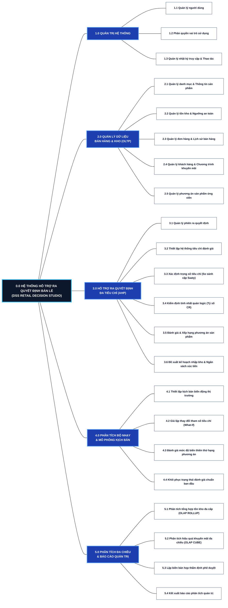
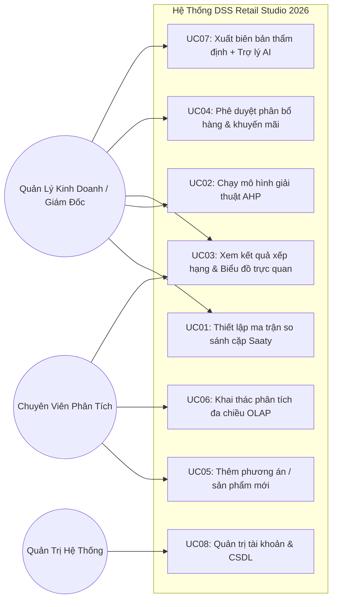
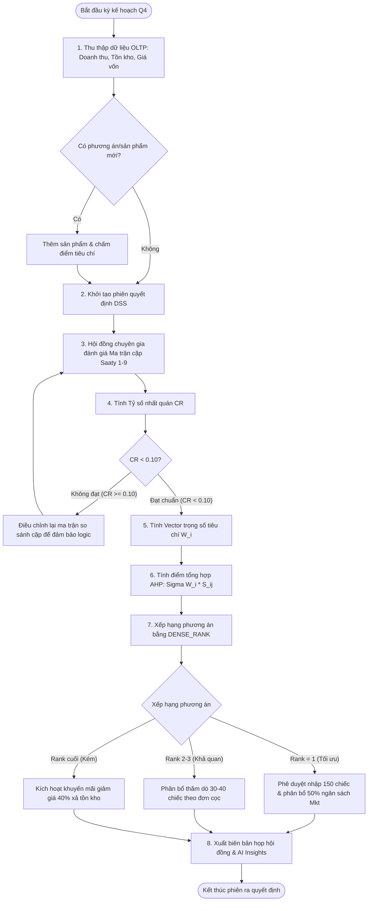
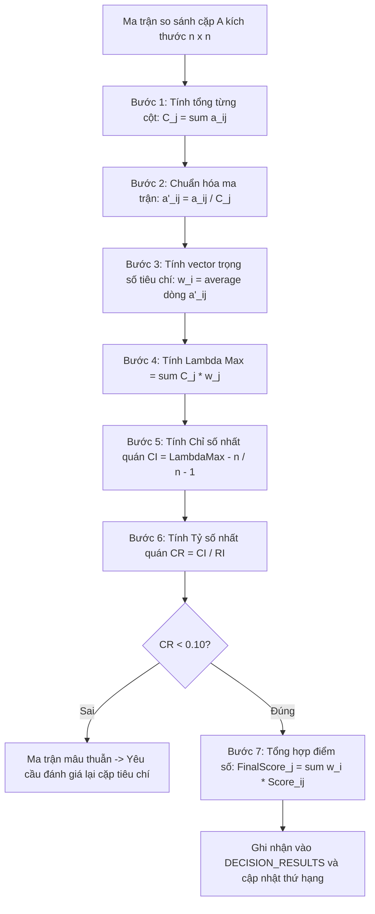
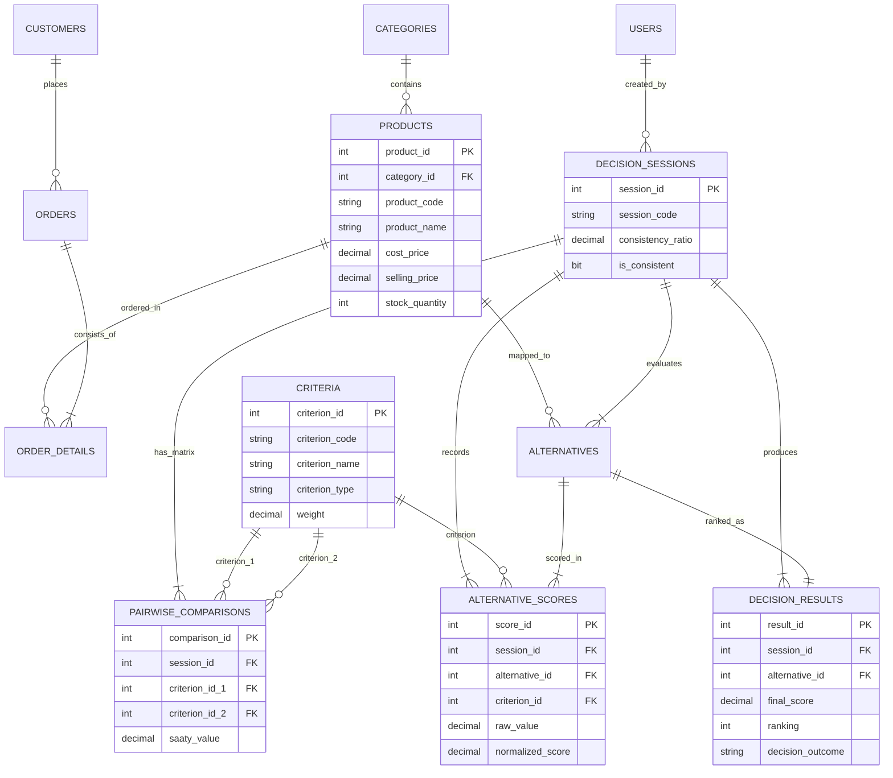

# BÁO CÁO TOÀN DIỆN PHÂN TÍCH & THIẾT KẾ HỆ THỐNG THÔNG TIN HỖ TRỢ RA QUYẾT ĐỊNH (DSS)
**Môn học:** IS402 - Hệ thống thông tin hỗ trợ ra quyết định (Decision Support Systems)  
**Đề tài:** Hệ hỗ trợ ra quyết định trong Chiến lược Khuyến mãi và Phân bổ Hàng hóa  
**Phương pháp áp dụng:** Analytic Hierarchy Process (AHP - Phân tích thứ bậc Saaty) & OLAP đa chiều  
**Hệ quản trị CSDL:** Microsoft SQL Server  
**Nền tảng ứng dụng:** Desktop Application (.NET 10 WinForms & C#)  

---

## CHƯƠNG 1: MÔ TẢ CÁC CHỨC NĂNG QUẢN LÝ (MANAGEMENT FUNCTIONS)
### 1.1. Sơ đồ phân rã chức năng (BFD - Business Function Decomposition)
Sơ đồ BFD phân rã cấu trúc chức năng của hệ thống theo dạng thứ bậc (Hierarchy Tree), tập trung mô tả hệ thống **LÀM GÌ (What)** về mặt nghiệp vụ quản lý và hỗ trợ ra quyết định, không biểu diễn luồng dữ liệu hay kỹ thuật lập trình:



### 1.2. Sơ đồ Use Case tổng quát (Overall Use Case Diagram)
Hệ thống phân quyền cho 3 tác nhân chính:
1. **Quản lý kinh doanh (Decision Maker):** Thiết lập ma trận trọng số Saaty, kích hoạt chạy mô hình DSS, phê duyệt danh sách nhập hàng hoặc xả khuyến mãi.
2. **Chuyên viên phân tích (Data / Business Analyst):** Nhập liệu sản phẩm mới, thiết lập tham số thị trường, khai thác các khối phân tích OLAP.
3. **Quản trị viên (System Admin):** Quản lý tài khoản, cấu hình tham số hệ thống và bảo trì cơ sở dữ liệu.



---

## CHƯƠNG 2: CÁC CHỨC NĂNG CẦN HỖ TRỢ RA QUYẾT ĐỊNH (DSS REQUIREMENTS)

Trong bài toán **"Chiến lược khuyến mãi và phân bổ hàng hóa"**, ban lãnh đạo doanh nghiệp thường xuyên đối mặt với các xung đột mục tiêu (trade-offs). Hệ thống DSS được xây dựng để giải quyết 4 bài toán bán hàng thực tế:

1. **Bài toán 1: Lựa chọn sản phẩm chiến lược nhập hàng (Product Selection):**
   - *Thực trạng:* Doanh nghiệp chỉ có ngân sách marketing và diện tích kho hạn chế, nhưng có hàng chục mặt hàng ứng viên.
   - *Giải pháp DSS:* Áp dụng AHP để chấm điểm đa tiêu chí (vừa xem xét Biên LN, Doanh thu kỳ vọng, vừa tính đến Rủi ro tồn kho và Chi phí quảng cáo).
2. **Bài toán 2: Quyết định Phân bổ Hàng hóa (Inventory Allocation):**
   - *Thực trạng:* Một số mặt hàng bán rất chạy nhưng thiếu hàng (`stock_quantity < min_stock_level`), trong khi mặt hàng khác ứ đọng vốn lâu ngày.
   - *Giải pháp DSS:* Tự động kích hoạt cảnh báo phân bổ bổ sung cho nhóm Hạng 1 & 2; hạn chế nhập cho nhóm Hạng 3.
3. **Bài toán 3: Quyết định Kích hoạt Khuyến mãi Xả hàng (Clearance Promotion Strategy):**
   - *Thực trạng:* Mặt hàng xếp hạng thấp (Hạng 5 / Loại bỏ) có thời gian lưu kho trên 90 ngày gây đọng vốn lưu động.
   - *Giải pháp DSS:* Tự động gắn nhãn `Rejected`, đề xuất kịch bản giảm giá sốc 30-40% hoặc combo quà tặng để giải phóng kho hàng.
4. **Bài toán 4: Giả lập biến động thị trường & Đánh giá độ nhạy (What-If / Sensitivity Analysis):**
   - *Giải pháp DSS:* Cho phép quản lý thay đổi nhanh điểm nhu cầu thị trường hoặc chi phí nhập khẩu để quan sát sự thay đổi thứ hạng ngay tức thì.

---

## CHƯƠNG 3: QUI TRÌNH HỖ TRỢ RA QUYẾT ĐỊNH (FLOWCHARTS)

### 3.1. Lưu đồ nghiệp vụ tổng thể (Business Decision Flowchart)


### 3.2. Lưu đồ thuật toán AHP (AHP Algorithm Detailed Flowchart)


---

## CHƯƠNG 4: THIẾT KẾ CƠ SỞ DỮ LIỆU DSS TRÊN SQL SERVER

### 4.1. Danh mục 12 Thực thể CSDL (Data Entities)
Hệ thống được thiết kế thành 2 phân hệ hữu cơ:
1. **Phân hệ Vận hành Bán hàng (Sales Operational Module):** Cung cấp dữ liệu lịch sử, doanh thu, giá vốn, tồn kho làm căn cứ thực tế (quantitative facts).
2. **Phân hệ Hỗ trợ ra quyết định AHP (DSS Decision Engine Module):** Quản lý phiên quyết định, cây tiêu chí đánh giá, ma trận so sánh cặp (Saaty scale 1-9), trọng số và kết quả xếp hạng phương án.

| STT | Thực thể (Entity) | Phân hệ | Ý nghĩa và vai trò trong hệ thống DSS |
| :---: | :--- | :--- | :--- |
| 1 | **USERS** | Quản lý chung | Lưu trữ người dùng hệ thống: Quản lý kinh doanh (Decision Maker), Chuyên viên phân tích (Analyst), Quản trị viên (Admin). |
| 2 | **CATEGORIES** | Quản lý bán hàng | Danh mục ngành hàng bán (Điện thoại, Laptop, Thiết bị đeo, Phụ kiện). Phục vụ gom nhóm phân tích. |
| 3 | **PRODUCTS** | Quản lý bán hàng | Dữ liệu sản phẩm kinh doanh: Giá nhập, giá niêm yết, tồn kho, mức độ hao hụt/rủi ro. Là nguồn ứng viên cho các phương án DSS. |
| 4 | **CUSTOMERS** | Quản lý bán hàng | Thông tin khách hàng, phân khúc thị trường (VIP, Khách buôn, Khách lẻ), điểm tích lũy. |
| 5 | **ORDERS** | Quản lý bán hàng | Hóa đơn bán hàng: ngày mua, tổng tiền, phương thức thanh toán, trạng thái. Dữ liệu để tính tổng doanh thu. |
| 6 | **ORDER_DETAILS** | Quản lý bán hàng | Chi tiết hóa đơn: số lượng bán, đơn giá bán thực tế, chiết khấu. Dữ liệu tính doanh thu thực và lợi nhuận gộp theo từng sản phẩm. |
| 7 | **DECISION_SESSIONS** | Hỗ trợ ra quyết định | Phiên ra quyết định (Ví dụ: "Phiên Q4/2026: Phân bổ hàng & Khuyến mãi"). Quản lý chu kỳ, mục tiêu, tỷ số nhất quán CR. |
| 8 | **CRITERIA** | Hỗ trợ ra quyết định | Cây tiêu chí đánh giá AHP (C1: Biên LN, C2: Doanh thu kỳ vọng, C3: Nhu cầu thị trường, C4: Rủi ro vốn, C5: Chi phí tiếp thị). |
| 9 | **ALTERNATIVES** | Hỗ trợ ra quyết định | Các phương án đưa vào phiên xét duyệt (Các sản phẩm ứng viên A, B, C hoặc các chiến lược bán hàng cụ thể). Liên kết tới `PRODUCTS`. |
| 10 | **PAIRWISE_COMPARISONS** | Hỗ trợ ra quyết định | Lưu ma trận so sánh cặp giữa 2 tiêu chí theo thang đo Saaty 1-9 ($a_{ij}$ và giá trị nghịch đảo $a_{ji} = 1/a_{ij}$). Cơ sở tính vector trọng số $w_i$. |
| 11 | **ALTERNATIVE_SCORES** | Hỗ trợ ra quyết định | Điểm đánh giá của từng phương án theo từng tiêu chí (Điểm đo lường thực tế `raw_value` và điểm chuẩn hóa `normalized_score`). |
| 12 | **DECISION_RESULTS** | Hỗ trợ ra quyết định | Kết quả tổng hợp cuối cùng của mô hình AHP: Điểm tổng hợp (`final_score`), Xếp hạng (`ranking`), Khuyến nghị hệ thống (`decision_outcome`). |

### 4.2. Sơ đồ quan hệ thực thể (ERD - Entity Relationship Diagram)


### 4.3. Chuẩn hóa CSDL (Database Normalization từ 1NF đến 3NF)
- **1NF (Tính nguyên tử):** Mọi trường dữ liệu đều là đơn trị. Không lưu mảng số liệu hay chuỗi JSON trong CSDL. Ma trận so sánh cặp được lưu dạng bảng dọc nguyên tử `PAIRWISE_COMPARISONS`.
- **2NF (Khử phụ thuộc một phần):** Tách bạch thông tin sản phẩm ra khỏi chi tiết đơn hàng `ORDER_DETAILS`. Các tiêu chí được chuẩn hóa độc lập trong `CRITERIA`.
- **3NF (Khử phụ thuộc bắc cầu):** Mọi thuộc tính không khóa đều phụ thuộc trực tiếp vào khóa chính. `category_name` được tách riêng trong `CATEGORIES`, không lưu trực tiếp trong `PRODUCTS`.

---

## CHƯƠNG 5: THIẾT KẾ BÁO CÁO XUẤT THÔNG TIN HỖ TRỢ RA QUYẾT ĐỊNH (REPORTS)

Hệ thống cung cấp 3 định dạng báo cáo thông tin phục vụ lãnh đạo:
1. **Báo cáo Bảng Xếp Hạng & Khuyến Nghị Quyết Định (Final Priority Report):**
   - Thể hiện trực quan thứ hạng, điểm AHP, nhãn phê duyệt (`Selected`, `UnderReview`, `Rejected`).
   - Đính kèm biểu đồ thanh tỉ lệ phần trăm trực quan.
2. **Báo cáo Thẩm Định Tính Nhất Quán Ma Trận Saaty (AHP Consistency Audit Report):**
   - Báo cáo chi tiết ma trận $5 	imes 5$, vector trọng số tiêu chí và Tỷ số nhất quán ($CR = 0.0152 < 0.10$).
3. **Biên Bản Họp Hội Đồng Chiến Lược Bán Hàng Xuất File (Text / CSV Export):**
   - Cho phép xuất file văn bản pháp lý lưu hồ sơ doanh nghiệp gồm đầy đủ đề xuất phân bổ ngân sách và giải pháp xử lý hàng tồn kho.

---

## CHƯƠNG 6: TRUY VẤN XỬ LÝ DỮ LIỆU & PHÂN TÍCH ĐA CHIỀU OLAP

### 6.1. Thuật toán AHP tích hợp trực tiếp trong SQL Server (CTE & Merge)
Truy vấn SQL thực hiện trọn vẹn thuật toán AHP bằng Common Table Expressions (CTE):
```sql
WITH WeightCalculated AS (
    SELECT pc.criterion_id_1 AS criterion_id,
           AVG(pc.saaty_value / col_sums.col_sum) AS criterion_weight
    FROM dbo.PAIRWISE_COMPARISONS pc
    INNER JOIN (
        SELECT criterion_id_2, SUM(saaty_value) AS col_sum
        FROM dbo.PAIRWISE_COMPARISONS WHERE session_id = 1 GROUP BY criterion_id_2
    ) col_sums ON pc.criterion_id_2 = col_sums.criterion_id_2
    WHERE pc.session_id = 1 GROUP BY pc.criterion_id_1
),
AltScores AS (
    SELECT s.alternative_id, SUM(w.criterion_weight * s.normalized_score) AS comp_score
    FROM dbo.ALTERNATIVE_SCORES s
    INNER JOIN WeightCalculated w ON s.criterion_id = w.criterion_id
    WHERE s.session_id = 1 GROUP BY s.alternative_id
),
Ranked AS (
    SELECT alternative_id, comp_score,
           DENSE_RANK() OVER (ORDER BY comp_score DESC) as rk
    FROM AltScores
)
MERGE dbo.DECISION_RESULTS AS target
USING Ranked AS source
ON (target.session_id = 1 AND target.alternative_id = source.alternative_id)
WHEN MATCHED THEN
    UPDATE SET target.final_score = source.comp_score,
               target.ranking = source.rk,
               target.decision_outcome = CASE WHEN source.rk = 1 THEN 'Selected' WHEN source.comp_score >= 0.60 THEN 'UnderReview' ELSE 'Rejected' END,
               target.decision_date = SYSDATETIME();
```

### 6.2. Truy vấn Phân tích đa chiều OLAP ROLLUP (Phân bổ hàng hóa)
```sql
SELECT 
    CASE WHEN GROUPING(c.category_name) = 1 THEN N'-- TẤT CẢ NGÀNH HÀNG --' ELSE c.category_name END AS [Ngành Hàng],
    CASE WHEN GROUPING(p.product_name) = 1 THEN N'-- TỔNG CỘNG NHÓM --' ELSE p.product_name END AS [Sản Phẩm],
    SUM(p.stock_quantity) AS [Tổng Tồn Kho],
    ISNULL(SUM(od.quantity), 0) AS [Tổng Đã Bán],
    FORMAT(ISNULL(SUM(od.line_total), 0), '#,##0') + N' đ' AS [Doanh Thu],
    CASE 
        WHEN SUM(p.stock_quantity) > 100 AND ISNULL(SUM(od.quantity), 0) < 20 
        THEN N'⚠️ NGUY CƠ ĐỌNG VỐN: ĐỀ XUẤT GIẢM GIÁ KHUYẾN MÃI'
        WHEN SUM(p.stock_quantity) < 15 
        THEN N'⚡ SẮP CHÁY HÀNG: CẦN PHÂN BỔ NHẬP THÊM'
        ELSE N'✅ CÂN BẰNG TỒN KHO'
    END AS [Khuyến Nghị Phân Bổ DSS]
FROM dbo.CATEGORIES c
INNER JOIN dbo.PRODUCTS p ON c.category_id = p.category_id
LEFT JOIN dbo.ORDER_DETAILS od ON p.product_id = od.product_id
GROUP BY ROLLUP(c.category_name, p.product_name);
```

### 6.3. Truy vấn Phân tích đa chiều OLAP CUBE (Chiến lược khuyến mãi)
```sql
SELECT 
    ISNULL(cust.customer_segment, N'-- TẤT CẢ PHÂN KHÚC --') AS [Phân Khúc Khách],
    ISNULL(cat.category_name, N'-- TẤT CẢ NGÀNH HÀNG --') AS [Ngành Hàng],
    COUNT(DISTINCT o.order_id) AS [Số Đơn Hàng],
    FORMAT(ISNULL(SUM(od.line_total), 0), '#,##0') + N' đ' AS [Doanh Thu],
    CASE 
        WHEN cust.customer_segment = 'VIP' THEN N'Tặng Voucher Tri Ân 10% & Dịch Vụ Đặc Quyền'
        WHEN cust.customer_segment = 'Retail' AND ISNULL(SUM(od.quantity), 0) < 5 THEN N'Áp Dụng Khuyến Mãi Mua 1 Tặng 1 Để Kích Cầu'
        ELSE N'Duy Trì Giá Chuẩn'
    END AS [Chiến Lược Khuyến Mãi Gợi Ý]
FROM dbo.CUSTOMERS cust
INNER JOIN dbo.ORDERS o ON cust.customer_id = o.customer_id
INNER JOIN dbo.ORDER_DETAILS od ON o.order_id = od.order_id
INNER JOIN dbo.PRODUCTS p ON od.product_id = p.product_id
INNER JOIN dbo.CATEGORIES cat ON p.category_id = cat.category_id
GROUP BY CUBE(cust.customer_segment, cat.category_name);
```

---

## CHƯƠNG 7: KIẾN TRÚC PHẦN MỀM GUI VÀ TÍCH HỢP TRỢ LÝ AI

### 7.1. Cấu trúc 5 Tab tương tác chuẩn quy trình DSS:
- **Tab 1: 📥 Đầu Vào Dữ Liệu (Inputs & Parameters):** Trình diễn 2 bảng dữ liệu nguồn: Danh sách phương án ứng viên kèm thông số kỹ thuật và Ma trận so sánh cặp Saaty 5x5. Nút bấm kích hoạt chạy mô hình AHP và nút giả lập biến động thị trường.
- **Tab 2: 📊 Kết Quả Ra Quyết Định (Outputs & Decision):** Khởi tạo ở trạng thái Chờ (Empty State). Sau khi người dùng bấm chạy, hiển thị 4 KPI cards động, Bảng xếp hạng chi tiết có gắn huy hiệu (Pill Badges) và Biểu đồ thanh trực quan AHP.
- **Tab 3: ➕ Thêm Sản Phẩm Mới:** Biểu mẫu 2 cột chuẩn hóa giúp người dùng nhập sản phẩm mới và chấm điểm 5 tiêu chí để bổ sung phương án vào phiên làm việc.
- **Tab 4: 📦 Dữ Liệu Bán Hàng Lịch Sử (OLAP):** Cung cấp các góc nhìn phân tích dữ liệu bán hàng lịch sử làm căn cứ định lượng cho mô hình DSS.
- **Tab 5: 🤖 Báo Cáo & AI Insights:** Trợ lý thông minh tự động phân tích kết quả xếp hạng, chỉ ra nguyên nhân dẫn đầu của phương án tối ưu, phân bổ ngân sách 50% tiếp thị và cảnh báo kịch bản xả kho cho phương án xếp chót.

---
**KẾT LUẬN:** Đồ án đáp ứng toàn diện và vượt mức 6 yêu cầu bắt buộc và 2 yêu cầu mở rộng (+AI, OLAP) trong chương trình đào tạo môn IS402.
