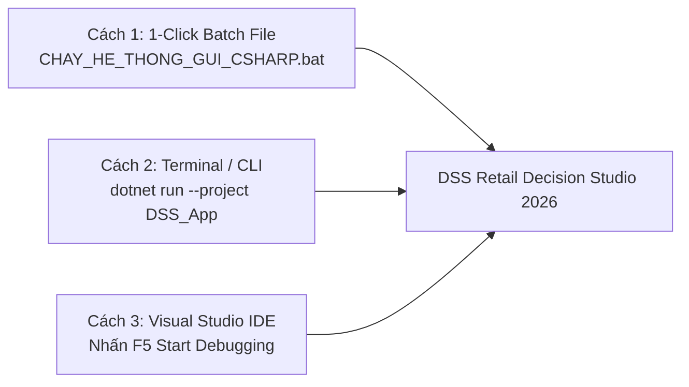
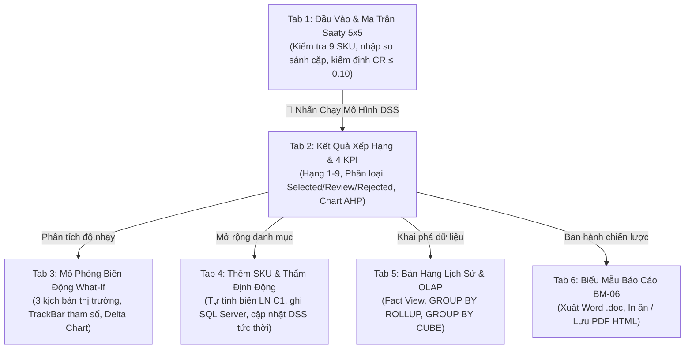

# DUY TÂN UNIVERSITY – INTERNATIONAL SCHOOL
## HỌC PHẦN: IS 402 A – HỆ THỐNG THÔNG TIN HỖ TRỢ RA QUYẾT ĐỊNH (DSS)
**Thời điểm nghiệm thu & phát hành: Tháng 10/2026**

---

# TÀI LIỆU HƯỚNG DẪN SỬ DỤNG HỆ THỐNG PHẦN MỀM HỖ TRỢ RA QUYẾT ĐỊNH
### (DSS USER MANUAL & SYSTEM OPERATION GUIDE)
**Hệ thống Hỗ trợ Ra Quyết định Chiến lược Khuyến mãi & Phân bổ Hàng hóa Quý 4/2026**  
*Phần mềm: DSS Retail Decision Studio 2026 (C# .NET 10.0 WinForms, AHP Saaty & SQL Server DSS_SalesDB)*

* **Nhóm sinh viên thực hiện (Nhóm 05)**:
  1. **Trần Hồng Minh** *(Trưởng nhóm - MSSV: 29210247142)*
  2. **Lê Thị Nga** *(MSSV: 29206361029)*
  3. **Phạm Ngọc Tú** *(MSSV: 29204347819)*
  4. **Lê Thanh Diệu** *(MSSV: 29204622434)*
  5. **Hồ Thị Thuận** *(MSSV: 29201164457)*
* **Giảng viên hướng dẫn (Approved by)**: ThS. Nguyễn Quang Ánh

---

## 📌 MỤC LỤC TỔNG QUAN

- [PHẦN 1: GIỚI THIỆU CHUNG & YÊU CẦU MÔI TRƯỜNG VẬN HÀNH](#phần-1-giới-thiệu-chung--yêu-cầu-môi-trường-vận-hành)
  - [1.1. Giới thiệu tổng quan hệ thống phần mềm](#11-giới-thiệu-tổng-quan-hệ-thống-phần-mềm)
  - [1.2. Mục tiêu bài toán hỗ trợ ra quyết định](#12-mục-tiêu-bài-toán-hỗ-trợ-ra-quyết-định)
  - [1.3. Yêu cầu cấu hình phần cứng & môi trường phần mềm](#13-yêu-cầu-cấu-hình-phần-cứng--môi-trường-phần-mềm)
  - [1.4. Danh mục tài khoản đăng nhập mẫu & Phân quyền RBAC](#14-danh-mục-tài-khoản-đăng-nhập-mẫu--phân-quyền-rbac)
- [PHẦN 2: HƯỚNG DẪN CÀI ĐẶT & THIẾT LẬP CƠ SỞ DỮ LIỆU](#phần-2-hướng-dẫn-cài-đặt--thiết-lập-cơ-sở-dữ-liệu)
  - [2.1. Cài đặt CSDL Microsoft SQL Server (DSS_SalesDB)](#21-cài-đặt-csdl-microsoft-sql-server-dss_salesdb)
  - [2.2. Kiểm tra chuỗi kết nối (Connection String)](#22-kiểm-tra-chuỗi-kết-nối-connection-string)
  - [2.3. Ba phương thức khởi chạy ứng dụng nhanh chóng](#23-ba-phương-thức-khởi-chạy-ứng-dụng-nhanh-chóng)
  - [2.4. Màn hình Khởi động Splash Screen & Giám sát kết nối ngầm](#24-màn-hình-khởi-động-splash-screen--giám-sát-kết-nối-ngầm)
- [PHẦN 3: HƯỚNG DẪN XÁC THỰC & BẢO MẬT HỆ THỐNG](#phần-3-hướng-dẫn-xác-thực--bảo-mật-hệ-thống)
  - [3.1. Hướng dẫn Đăng nhập hệ thống (Login Form)](#31-hướng-dẫn-đăng-nhập-hệ-thống-login-form)
  - [3.2. Hướng dẫn Đăng ký tài khoản người dùng mới (Register Form)](#32-hướng-dẫn-đăng-ký-tài-khoản-người-dùng-mới-register-form)
  - [3.3. Thông tin người dùng trên Header & Quản trị phiên](#33-thông-tin-người-dùng-trên-header--quản-trị-phiên)
- [PHẦN 4: HƯỚNG DẪN CHI TIẾT THAO TÁC NGHIỆP VỤ DSS (6 TABS)](#phần-4-hướng-dẫn-chi-tiết-thao-tác-nghiệp-vụ-dss-6-tabs)
  - [4.1. Tab 1: Thiết lập Dữ liệu Đầu vào & Ma trận Saaty 5x5](#41-tab-1-thiết-lập-dữ-liệu-đầu-vào--ma-trận-saaty-5x5)
  - [4.2. Tab 2: Xem Bảng Xếp Hạng, 4 KPI & Khuyến Nghị Quản Trị](#42-tab-2-xem-bảng-xếp-hạng-4-kpi--khuyến-nghị-quản-trị)
  - [4.3. Tab 3: Mô Phỏng Biến Động Thị Trường & Độ Nhạy What-If](#43-tab-3-mô-phỏng-biến-động-thị-trường--độ-nhạy-what-if)
  - [4.4. Tab 4: Thêm Sản Phẩm Mới & Thẩm Định Động](#44-tab-4-thêm-sản-phẩm-mới--thẩm-định-động)
  - [4.5. Tab 5: Khai Phá & Phân Tích Bán Hàng Đa Chiều OLAP](#45-tab-5-khai-phá--phân-tích-bán-hàng-đa-chiều-olap)
  - [4.6. Tab 6: Biểu Mẫu Báo Cáo Thẩm Định & Phê Duyệt BM-06](#46-tab-6-biểu-mẫu-báo-cáo-thẩm-định--phê-duyệt-bm-06)
- [PHẦN 5: CƠ CHẾ AN TOÀN FAIL-SAFE & XỬ LÝ SỰ CỐ (TROUBLESHOOTING)](#phần-5-cơ-chế-an-toàn-fail-safe--xử-lý-sự-cố-troubleshooting)
  - [5.1. Cơ chế khóa an toàn DatabaseGuard Security Overlay](#51-cơ-chế-khóa-an-toàn-databaseguard-security-overlay)
  - [5.2. Các lỗi thường gặp và cách khắc phục nhanh](#52-các-lỗi-thường-gặp-và-cách-khắc-phục-nhanh)
  - [5.3. Bảng câu hỏi thường gặp (FAQ)](#53-bảng-câu-hỏi-thường-gặp-faq)
- [PHẦN 6: KẾT LUẬN & LIÊN HỆ HỖ TRỢ KỸ THUẬT](#phần-6-kết-luận--liên-hệ-hỗ-trợ-kỹ-thuật)

---

## 🖼️ DANH MỤC HÌNH ẢNH HƯỚNG DẪN THAO TÁC

| Mã Hình | Nội Dung Minh Họa Thao Tác | Vị Trí Trong Tài Liệu |
| :---: | :--- | :---: |
| **Hình 1** | Màn hình Khởi động & Kiểm tra kết nối CSDL ngầm (`SplashForm` - GUI-01) | [Mục 2.4](#24-màn-hình-khởi-động-splash-screen--giám-sát-kết-nối-ngầm) |
| **Hình 2** | Màn hình Đăng nhập xác thực SHA-256 & 4 Nút Chọn Nhanh Demo (`LoginForm` - GUI-02) | [Mục 3.1](#31-hướng-dẫn-đăng-nhập-hệ-thống-login-form) |
| **Hình 3** | Màn hình Đăng ký tài khoản người dùng mới & Phân quyền RBAC (`RegisterForm` - GUI-03) | [Mục 3.2](#32-hướng-dẫn-đăng-ký-tài-khoản-người-dùng-mới-register-form) |
| **Hình 4** | Tab 1: Tra cứu danh mục 9 sản phẩm & Thiết lập Ma trận Saaty 5x5 (GUI-04) | [Mục 4.1](#41-tab-1-thiết-lập-dữ-liệu-đầu-vào--ma-trận-saaty-5x5) |
| **Hình 5** | Tab 2: Xem kết quả xếp hạng DSS, 4 KPI, Biểu đồ cột AHP & Khuyến nghị (GUI-05) | [Mục 4.2](#42-tab-2-xem-bảng-xếp-hạng-4-kpi--khuyến-nghị-quản-trị) |
| **Hình 6** | Tab 3: Mô phỏng What-If với 3 kịch bản thị trường & Biểu đồ đường Delta (GUI-06) | [Mục 4.3](#43-tab-3-mô-phỏng-biến-động-thị-trường--độ-nhạy-what-if) |
| **Hình 7** | Tab 4: Thêm sản phẩm mới, tự động tính biên LN C1 & Thẩm định động (GUI-07) | [Mục 4.4](#44-tab-4-thêm-sản-phẩm-mới--thẩm-định-động) |
| **Hình 8** | Tab 5: Khai phá dữ liệu bán hàng lịch sử OLAP (Fact View, ROLLUP, CUBE - GUI-08) | [Mục 4.5](#45-tab-5-khai-phá--phân-tích-bán-hàng-đa-chiều-olap) |
| **Hình 9** | Tab 6: Biểu mẫu báo cáo thẩm định BM-06, xuất file Word & HTML/PDF (GUI-09) | [Mục 4.6](#46-tab-6-biểu-mẫu-báo-cáo-thẩm-định--phê-duyệt-bm-06) |
| **Hình 10**| Màn hình Khóa an toàn Fail-Safe khi ngắt kết nối CSDL (`DatabaseGuard` - GUI-10) | [Mục 5.1](#51-cơ-chế-khóa-an-toàn-databaseguard-security-overlay) |

---

## PHẦN 1: GIỚI THIỆU CHUNG & YÊU CẦU MÔI TRƯỜNG VẬN HÀNH

### 1.1. Giới thiệu tổng quan hệ thống phần mềm
**DSS Retail Decision Studio 2026** là phần mềm hệ thống thông tin hỗ trợ ra quyết định (Decision Support System - DSS) chuyên dụng dành cho các chuỗi bán lẻ công nghệ và thiết bị thông minh. Phần mềm được thiết kế và hiện thực hóa trong khuôn khổ đồ án môn học **IS 402 A** của Khoa Hệ thống Thông tin Quản lý (MIS) – Trường Đào tạo Quốc tế, Đại học Duy Tân.

Hệ thống kết hợp ba nền tảng công nghệ trụ cột:
1. **Giao diện tương tác người dùng (Dialog System):** Xây dựng trên C# .NET 10.0 Windows Forms hiện đại, tối ưu công thái học, không vệt đen GDI+, bố cục thẻ Card trực quan.
2. **Kho cơ sở dữ liệu quan hệ (Data Management):** Microsoft SQL Server (`DSS_SalesDB`) với 11 bảng thực thể chuẩn 3NF, lưu trữ dữ liệu bán lẻ OLTP và cấu trúc đa chiều OLAP.
3. **Bộ não mô hình toán học (Model Base):** Thuật toán Phân tích Thứ bậc AHP (*Analytic Hierarchy Process*) của Thomas L. Saaty, tự động chuẩn hóa hàm Benefit/Cost, kiểm định tỷ số nhất quán $CR \le 0.10$ và phân bổ ngân sách tối ưu.

---

### 1.2. Mục tiêu bài toán hỗ trợ ra quyết định
Bài toán trọng tâm được phần mềm giải quyết:
> *"Hỗ trợ Ban Giám Đốc và Bộ phận Thu mua lựa chọn Danh mục Sản phẩm Chiến lược để Phân bổ Ngân sách Nhập hàng & Tiếp thị phục vụ Chiến dịch Cao điểm Bán lẻ Quý 4/2026."*

Các giá trị cốt lõi mang lại:
* **Khách quan hóa quyết định:** Thay thế phương pháp chọn hàng cảm tính bằng 5 tiêu chí rõ ràng: Biên lợi nhuận ($C_1$), Doanh thu kỳ vọng ($C_2$), Nhu cầu thị trường ($C_3$), Rủi ro tồn kho ($C_4$), Chi phí Marketing ($C_5$).
* **Phân loại 3 nhóm rõ rệt:** Tự động gắn nhãn quyết định: `Selected` (Phê duyệt rót vốn), `UnderReview` (Thăm dò thị trường), `Rejected` (Loại bỏ, xả kho).
* **Công thức gợi ý số lượng đặt hàng an toàn:** Dựa trên nhu cầu trung bình ngày, thời gian giao hàng (Lead Time) và chu kỳ bổ sung 30 ngày.

---

### 1.3. Yêu cầu cấu hình phần cứng & môi trường phần mềm

| Thành Phần Kỹ Thuật | Cấu Hình Tối Thiểu (Minimum) | Cấu Hình Khuyến Nghị (Recommended) |
| :--- | :--- | :--- |
| **Bộ vi xử lý (CPU)** | Intel Core i3 Gen 8 / AMD Ryzen 3 trở lên | Intel Core i5 / i7 Gen 11+ hoặc Apple Silicon M-series (Parallels) |
| **Bộ nhớ RAM** | Tối thiểu 4.0 GB RAM trống | 8.0 GB - 16.0 GB RAM DDR4/DDR5 |
| **Ổ cứng lưu trữ** | Tối thiểu 1.0 GB dung lượng trống (SSD) | SSD NVMe PCIe trống tối thiểu 5.0 GB |
| **Hệ điều hành** | Microsoft Windows 10 x64 (Build 19041+) | Microsoft Windows 11 x64 Pro (phiên bản mới nhất) |
| **Môi trường thực thi** | .NET Desktop Runtime 10.0 (x64) | .NET SDK 10.0 hoặc .NET Desktop Runtime 10.0.0+ |
| **Hệ quản trị CSDL** | Microsoft SQL Server 2022 / 2025 Express | SQL Server 2022/2025 Developer hoặc Enterprise Edition |
| **Độ phân giải màn hình** | 1366 x 768 pixels (Chuẩn HD) | 1920 x 1080 (Full HD) hoặc cao hơn, hỗ trợ High-DPI |
| **Phần mềm phụ trợ** | Microsoft Word / Excel 2016+ (xem báo cáo) | Microsoft Word 365, Google Chrome / MS Edge (in PDF) |

---

### 1.4. Danh mục tài khoản đăng nhập mẫu & Phân quyền RBAC

Hệ thống cấu hình sẵn 4 tài khoản mẫu đại diện cho 4 vai trò tác nghiệp trong doanh nghiệp:

| Tài Khoản | Họ Và Tên Cán Bộ | Vai Trò (Role) | Mật Khẩu Mẫu | Quyền Hạn Và Phạm Vi Tác Vụ Trong Hệ Thống |
| :---: | :--- | :---: | :---: | :--- |
| **NV000** | Nguyễn Huy Hoàng | `DecisionMaker` | `Admin@123` | Toàn quyền ra quyết định, chạy AHP, duyệt kế hoạch nhập hàng, ký duyệt báo cáo thẩm định BM-06. |
| **admin** | Quản Trị Viên | `Administrator` | `Admin@123` | Toàn quyền cấu hình kết nối CSDL, sao lưu/phục hồi dữ liệu, cấp phát tài khoản nhân viên mới. |
| **NV002** | Trần Thị Mai | `SalesManager` | `Admin@123` | Khai phá dữ liệu đa chiều OLAP, phân tích độ nhạy What-If, xuất báo cáo Word và in ấn PDF. |
| **NV003** | Lê Văn An | `SalesStaff` | `Admin@123` | Tra cứu hiệu suất bán lẻ, theo dõi tồn kho, chỉ có quyền xem (Read-Only) trên các bảng tính DSS. |

> [!NOTE]
> Mọi mật khẩu đều được băm bảo mật SHA-256 trong bảng `dbo.USERS`. Trên giao diện đăng nhập có sẵn **4 nút 1-Click Demo** cho phép chuyển đổi nhanh giữa các tài khoản mà không cần gõ bàn phím.

---

## PHẦN 2: HƯỚNG DẪN CÀI ĐẶT & THIẾT LẬP CƠ SỞ DỮ LIỆU

### 2.1. Cài đặt CSDL Microsoft SQL Server (DSS_SalesDB)
Thực hiện tuần tự 5 bước sau để chuẩn bị dữ liệu:
1. **Bước 1:** Khởi động công cụ **SQL Server Management Studio (SSMS)** hoặc **Azure Data Studio**.
2. **Bước 2:** Kết nối tới máy chủ SQL Server cục bộ (ví dụ: `.\SQLEXPRESS25` hoặc `localhost`).
3. **Bước 3:** Mở và chạy file [01_create_database.sql](file:///g:/Decision%20System/sql/01_create_database.sql) để tạo cơ sở dữ liệu `DSS_SalesDB` với 11 bảng thực thể đạt chuẩn 3NF.
4. **Bước 4:** Mở và chạy file [02_seed_data.sql](file:///g:/Decision%20System/sql/02_seed_data.sql) để nạp 9 sản phẩm ứng viên và ma trận Saaty chuẩn toán học ($CR = 0.0152 \le 10\%$).
5. **Bước 5:** Mở và chạy file [03_dss_reports_and_queries.sql](file:///g:/Decision%20System/sql/03_dss_reports_and_queries.sql) để tạo View hiệu suất bán hàng `vw_DSS_ProductPerformance` và các thủ tục OLAP.

---

### 2.2. Kiểm tra chuỗi kết nối (Connection String)
Chuỗi kết nối chuẩn trong mã nguồn C# `DatabaseGuard` / `DbConfig`:
```csharp
"Data Source=.\\SQLEXPRESS25;Initial Catalog=DSS_SalesDB;Integrated Security=True;TrustServerCertificate=True;Connect Timeout=5;"
```
*(Nếu sử dụng máy chủ hoặc instance khác, người dùng chỉ cần cập nhật lại thuộc tính `Data Source` tương ứng).*

---

### 2.3. Ba phương thức khởi chạy ứng dụng nhanh chóng



* **Cách 1 (Khuyên dùng):** Nhấp đúp chuột vào file [CHAY_HE_THONG_GUI_CSHARP.bat](file:///g:/Decision%20System/CHAY_HE_THONG_GUI_CSHARP.bat) tại thư mục gốc. Hệ thống tự động biên dịch và khởi chạy chỉ trong 3 giây.
* **Cách 2:** Mở PowerShell tại thư mục dự án và gõ lệnh:
  ```powershell
  dotnet run --project "g:\Decision System\DSS_App\DSS_App.csproj"
  ```
* **Cách 3:** Mở solution bằng Visual Studio 2022/2025 và nhấn `F5`.

---

### 2.4. Màn hình Khởi động Splash Screen & Giám sát kết nối ngầm


*Hình 1: Màn hình Khởi động & Kiểm tra kết nối CSDL tự động (Splash Screen - GUI-01)*

* **Thao tác người dùng:** Hoàn toàn tự động, không cần thao tác chuột hay bàn phím.
* **Diễn giải:** Thanh `ProgressBar` tăng dần từ 0% đến 100%. Hệ thống gọi ngầm `DatabaseGuard.Ping()` kiểm tra kết nối SQL Server. Hộp trạng thái hiển thị `DatabaseGuard: Online • Latency: 3.2ms`. Khi đạt 100%, màn hình tự động chuyển sang `LoginForm`.

---

## PHẦN 3: HƯỚNG DẪN XÁC THỰC & BẢO MẬT HỆ THỐNG

### 3.1. Hướng dẫn Đăng nhập hệ thống (Login Form)


*Hình 2: Màn hình Đăng nhập xác thực SHA-256 & 4 Nút Chọn Nhanh Demo (GUI-02)*

#### Thao tác đăng nhập thủ công:
1. Nhập tên tài khoản vào ô **Tài khoản** (ví dụ: `NV000`).
2. Nhập mật khẩu vào ô **Mật khẩu** (ký tự mặc định ẩn dạng dấu chấm tròn). Nhấp biểu tượng con mắt 👁 để hiển thị hoặc ẩn mật khẩu.
3. Tích chọn **"Ghi nhớ tài khoản trên thiết bị này"** nếu muốn tự động điền trong các phiên sau.
4. Nhấn nút **"🔐 ĐĂNG NHẬP HỆ THỐNG"** màu Indigo hoặc nhấn phím tắt **Enter**.

#### Tiện ích 1-Click Demo (Dành cho Giám khảo & Thẩm định nhanh):
Người dùng chỉ cần nhấp vào 1 trong 4 nút:
* `👑 DecisionMaker: NV000 (Nguyễn Huy Hoàng)`: Tự động đăng nhập Người ra quyết định tối cao.
* `⚙️ Administrator: admin (Quản trị hệ thống)`: Tự động đăng nhập Quản trị viên CSDL.
* `📊 SalesManager: NV002 (Trần Thị Mai)`: Tự động đăng nhập Trưởng phòng Phân tích & OLAP.
* `💼 SalesStaff: NV003 (Lê Văn An)`: Tự động đăng nhập Chuyên viên bán hàng.

---

### 3.2. Hướng dẫn Đăng ký tài khoản người dùng mới (Register Form)


*Hình 3: Màn hình Đăng ký tài khoản người dùng mới & Phân quyền RBAC (GUI-03)*

1. Từ màn hình đăng nhập, nhấp vào liên kết **"Chưa có tài khoản? 👉 Đăng ký tài khoản mới"**.
2. Điền thông tin vào các trường bắt buộc: Họ và tên, Mã nhân viên (dạng `NVxxx`), Tên đăng nhập (4-30 ký tự), Email doanh nghiệp (regex chuẩn `@domain.vn`), Mật khẩu và Xác nhận mật khẩu.
3. Chọn vai trò tại hộp dropdown: `DecisionMaker`, `Administrator`, `SalesManager` hoặc `SalesStaff`.
4. Nhấn **"✅ ĐĂNG KÝ TÀI KHOẢN"**. Hệ thống băm SHA-256 mật khẩu, lưu vào SQL Server và thông báo thành công.

---

### 3.3. Thông tin người dùng trên Header & Quản trị phiên
Khi đăng nhập thành công vào màn hình chính `Form1`:
* **Thanh Header:** Hiển thị tên cán bộ (`Nguyễn Huy Hoàng • NV000`), huy hiệu vai trò màu nổi bật (`DecisionMaker`), đèn báo CSDL (`🟢 CSDL: Online • Latency: 2.8ms`).
* **Đăng xuất an toàn:** Nhấn nút **"🚪 Đăng xuất"** màu đỏ ở góc trên bên phải. Hệ thống hiển thị hộp thoại xác nhận an toàn trước khi đóng phiên làm việc và quay lại `LoginForm`.

---

## PHẦN 4: HƯỚNG DẪN CHI TIẾT THAO TÁC NGHIỆP VỤ DSS (6 TABS)



---

### 4.1. Tab 1: Thiết lập Dữ liệu Đầu vào & Ma trận Saaty 5x5


*Hình 4: Tab 1 - Danh Mục 9 Sản Phẩm Ứng Viên & Ma Trận So Sánh Cặp Saaty 5x5 (GUI-04)*

#### Thao tác tra cứu danh mục sản phẩm (Cột trái):
* Bảng danh mục hiển thị 9 sản phẩm ứng viên: Asus ROG Strix G16, Acer Nitro 16, Dell Alienware m16, iPhone 16 Pro Max, Samsung Galaxy S24 Ultra, Xiaomi 14 Pro, Sony WH-1000XM5, Marshall Stanmore III, DJI Mini 4 Pro.
* Người dùng đối soát các tham số: Giá vốn, Giá bán, Tồn kho hiện tại và Tỷ suất biên lợi nhuận gộp (%).

#### Thao tác nhập ma trận so sánh cặp Saaty 5x5 (Cột phải):
* So sánh 5 tiêu chí: $C_1$ (Biên LN), $C_2$ (Doanh thu kỳ vọng), $C_3$ (Nhu cầu thị trường), $C_4$ (Rủi ro tồn kho), $C_5$ (Chi phí Marketing) theo thang đo 1-9.
* **Cơ chế tự động:** Người dùng chỉ cần nhập các ô ở nửa trên đường chéo chính. Phần tử đối xứng qua đường chéo tự động nghịch đảo: $a_{ji} = 1 / a_{ij}$.

#### Kiểm soát tỷ số nhất quán $CR$:
* **Trạng thái Đạt chuẩn ($CR \le 0.10$):** Nhãn hiển thị màu xanh lá `🟢 Tỷ số CR = 0.0152 (1.52% ≤ 10%) - ĐẠT CHUẨN NHẤT QUÁN`.
* **Trạng thái Cảnh báo ($CR > 0.10$):** Nhãn chuyển sang màu đỏ rực `🔴 TỶ SỐ CR = 0.1450 > 10% - CẢNH BÁO MÂU THUẪN`. Nút chạy DSS bị khóa, buộc người dùng phải hiệu chỉnh lại các cặp so sánh để đảm bảo tính bắc cầu toán học.
* **Kích hoạt DSS:** Nhấn nút **"🚀 CHẠY MÔ HÌNH DSS NGAY"** màu Indigo. Hệ thống tính toán vector trọng số $w_i$, chuẩn hóa ma trận và tự động chuyển sang Tab 2.

---

### 4.2. Tab 2: Xem Bảng Xếp Hạng, 4 KPI & Khuyến Nghị Quản Trị


*Hình 5: Tab 2 - Bảng Xếp Hạng Phương Án, 4 KPI Điều Hành & Biểu Đồ Cột AHP (GUI-05)*

#### Đọc 4 Thẻ Chỉ Số KPI Điều Hành:
1. **LỰA CHỌN HÀNG ĐẦU (Nền xanh ngọc):** Hiển thị Quán quân AHP (*Asus ROG Strix G16 • Điểm 0.2458 • PHÊ DUYỆT*).
2. **TỶ SỐ NHẤT QUÁN CR (Nền xanh dương):** Đạt chuẩn Saaty $CR = 0.0152$ ($1.52\% \le 10\%$).
3. **DOANH THU KỲ VỌNG (Nền tím):** Doanh thu kỳ vọng 850 Triệu VNĐ với tỷ suất lợi nhuận gộp 30.14%.
4. **TỔNG SỐ PHƯƠNG ÁN (Nền vàng cam):** 9 Phương án (1 Chọn • 3 Xem xét • 5 Loại bỏ).

#### Đọc Bảng Xếp Hạng Phương Án:
* **Huy hiệu Thứ hạng:** Hạng 1 (Vàng Gold), Hạng 2 (Bạc Silver), Hạng 3 (Đồng Bronze), các hạng còn lại xám nhạt.
* **Huy hiệu Phê duyệt (Pill):**
  * `Selected` (Xanh lá): Phê duyệt nhập hàng và rót vốn tối đa.
  * `UnderReview` (Vàng cam): Cần xem xét thêm, đặt hàng thăm dò số lượng vừa phải.
  * `Rejected` (Đỏ hồng): Loại bỏ khỏi danh mục giải ngân Quý 4, tập trung xả tồn kho.
* **SL Đặt hàng gợi ý:** Tự động tính theo công thức an toàn tồn kho:
  $$\text{Suggested\_Qty} = \max\Big(0,\; \text{Nhu\_cau} \times (\text{Lead\_Time} + 30) - \text{Ton\_kho}\Big)$$
* **Phân bổ Marketing:** Tự động chia tỷ trọng ngân sách tiếp thị theo tỷ lệ điểm AHP của các sản phẩm nhóm `Selected`.

#### Biểu Đồ Cột AHP & Hộp Khuyến Nghị Điều Hành:
* Biểu đồ cột tự động co giãn thể hiện trực quan khoảng cách điểm số giữa các sản phẩm.
* Hộp nhận xét tự động sinh các đoạn phân tích kinh doanh sắc bén: Đánh giá thế mạnh của sản phẩm Hạng 1 và cảnh báo nguy cơ đọng vốn đối với các sản phẩm cuối bảng.

---

### 4.3. Tab 3: Mô Phỏng Biến Động Thị Trường & Độ Nhạy What-If


*Hình 6: Tab 3 - Mô Phỏng Biến Động Thị Trường What-If & Biểu Đồ Đường Độ Nhạy Delta (GUI-06)*

#### Ba Kịch Bản Thị Trường Vĩ Mô Định Sẵn (1-Click):
* **🔥 Kịch Bản 1 (Bùng Nổ Gaming):** Tăng $+40\%$ nhu cầu thị trường mảng laptop và phụ kiện gaming. Xem Asus ROG Strix G16 và Acer Nitro 16 bứt phá điểm số.
* **⚡ Kịch Bản 2 (Đứt Gãy Cung Ứng):** Tăng gấp đôi rủi ro tồn kho ($C_4$) và thời gian giao hàng. Các dòng máy cồng kềnh bị hạ điểm, ưu tiên sản phẩm nhỏ gọn.
* **📉 Kịch Bản 3 (Lạm Phát Thắt Chặt):** Suy giảm sức mua, ưu tiên dòng máy phổ thông giá rẻ có biên lợi nhuận an toàn.
* **🔄 Nút Khôi Phục Dữ Liệu Gốc:** Hoàn nguyên toàn bộ các tham số về trạng thái ban đầu (*Baseline*).

#### Tinh chỉnh tham số vi mô in-memory:
1. Chọn 1 sản phẩm cần thử nghiệm trong hộp chọn dropdown.
2. Kéo thanh trượt điều chỉnh: Nhu cầu ($C_3$), Biên LN ($C_1$), An toàn vốn ($C_4$).
3. Nhấn **"⚡ Áp Dụng Tham Số"**: Hệ thống tái tính toán điểm AHP tức thời mà không làm thay đổi dữ liệu gốc trong CSDL.

#### Đồ họa trực quan hóa:
* **Nút "📈 Biểu Đồ Đường Độ Nhạy":** Hiển thị Biểu đồ đường Delta Line Chart so sánh đường điểm số gốc và đường điểm số sau mô phỏng.
* **Nút "🌳 Sơ Đồ Cây Phân Cấp AHP":** Hiển thị Cây thứ bậc Saaty 3 tầng có mũi tên liên kết giữa Mục tiêu ➔ 5 Tiêu chí ➔ 9 Phương án.

---

### 4.4. Tab 4: Thêm Sản Phẩm Mới & Thẩm Định Động


*Hình 7: Tab 4 - Nhập Sản Phẩm Mới, Tự Tính Biên LN & Thẩm Định Động (GUI-07)*

1. **Nhập thông tin bán hàng (Thẻ bên trái):** Tên sản phẩm, Mã SKU (`PRD_xxx`), chọn Ngành hàng, Giá vốn (VNĐ), Giá bán niêm yết (VNĐ), Tồn kho ban đầu.
2. **Quan sát tính toán tự động:** Hệ thống tự động tính tỷ suất lợi nhuận gộp:
   $$\text{Biên LN (\%)} = \frac{\text{Giá Bán} - \text{Giá Vốn}}{\text{Giá Bán}} \times 100\%$$
   Ô nhập $C_1$ ở thẻ bên phải bị khóa cứng (`ReadOnly`), tự động nạp giá trị này, ngăn chặn sai lệch số liệu.
3. **Nhập 4 điểm tiêu chí DSS (Thẻ bên phải):** Doanh thu kỳ vọng ($C_2$), Nhu cầu ($C_3$), Số ngày tồn kho ($C_4$), Chi phí Marketing ($C_5$).
4. **Lưu và chạy lại DSS:** Nhấn nút **"💾 LƯU SẢN PHẨM & CẬP NHẬT"**. Hệ thống thực thi Transaction lưu vào cả hai bảng `PRODUCTS` và `ALTERNATIVES`, tự động tính toán lại toàn bộ xếp hạng AHP cho danh mục mới mà không cần khởi động lại ứng dụng.

---

### 4.5. Tab 5: Khai Phá & Phân Tích Bán Hàng Đa Chiều OLAP


*Hình 8: Tab 5 - Dữ Liệu Bán Hàng Lịch Sử & Ba Chế Độ Phân Tích OLAP (GUI-08)*

* **Chế độ 1 - Bấm nút "📊 1. Hiệu Suất Sản Phẩm":** Truy vấn View `vw_DSS_ProductPerformance` hiển thị doanh số, doanh thu thực thu, lợi nhuận gộp và tốc độ bán trung bình ngày của từng SKU.
* **Chế độ 2 - Bấm nút "📦 2. OLAP ROLLUP: Tồn Kho":** Thực thi câu lệnh `GROUP BY ROLLUP(c.category_name, p.product_name)`. Cho phép xem dữ liệu phân cấp từ SKU cuộn lên tổng mức Ngành hàng và Toàn chuỗi.
* **Chế độ 3 - Bấm nút "🎯 3. OLAP CUBE: Khuyến Mãi":** Thực thi `GROUP BY CUBE(cust.customer_segment, cat.category_name)`. Ma trận đa chiều phân tích doanh thu chéo giữa từng Phân khúc khách hàng và từng Ngành hàng.
* Khung chú giải phía dưới hiển thị giải thích chi tiết câu lệnh T-SQL đang chạy.

---

### 4.6. Tab 6: Biểu Mẫu Báo Cáo Thẩm Định & Phê Duyệt BM-06


*Hình 9: Tab 6 - Biểu Mẫu Báo Cáo Thẩm Định BM-06, Xuất File Word & HTML/PDF (GUI-09)*

* **Đọc văn bản hành chính:** Biểu mẫu BM-06/DSS-2026/Q4 tích hợp đầy đủ bảng kế hoạch phân bổ chi tiết và 3 chỉ thị hành động của Ban Giám Đốc.
* **Xuất file Word:** Nhấn nút **"📝 Xuất File Word (.doc)"** màu xanh dương để trích xuất toàn bộ bảng số liệu và nhận xét ra file Word tại thư mục báo cáo.
* **In ấn / Lưu PDF:** Nhấn nút **"🖨️ In Báo Cáo / Lưu PDF"** màu xanh Emerald để mở trang HTML trực tiếp trên trình duyệt web, sẵn sàng bấm `Ctrl + P` in ấn hoặc lưu PDF.
* **Cập nhật dữ liệu:** Nhấn nút **"🔄 Cập Nhật Dữ Liệu"** để đồng bộ lại dữ liệu nếu vừa có sự thay đổi từ các Tab khác.

---

## PHẦN 5: CƠ CHẾ AN TOÀN FAIL-SAFE & XỬ LÝ SỰ CỐ (TROUBLESHOOTING)

### 5.1. Cơ chế khóa an toàn DatabaseGuard Security Overlay


*Hình 10: Màn hình Khóa An Toàn Khi Mất Kết Nối CSDL (DatabaseGuard Security Overlay - GUI-10)*

* **Hiện tượng:** Khi mất kết nối SQL Server hoặc đứt dây mạng, một lớp phủ màu tối sẽ lập tức che phủ toàn bộ màn hình và khóa cứng mọi thao tác.
* **Mục đích:** Ngăn ngừa người dùng bấm nút ra quyết định trên tập dữ liệu bị đứt gãy, chống sập ứng dụng (*Crash-Free*).
* **Khắc phục:** Sau khi khởi động lại dịch vụ SQL Server hoặc cắm lại mạng, nhấp nút **"↻ Thử Kết Nối Lại"**. Khi kết nối thành công, lớp overlay tự động biến mất và dữ liệu được nạp lại nguyên vẹn.

---

### 5.2. Các lỗi thường gặp và cách khắc phục nhanh

| Hiện Tượng / Thông Báo Lỗi | Nguyên Nhân Kỹ Thuật | Quy Trình Xử Lý Khắc Phục (Troubleshooting) |
| :--- | :--- | :--- |
| **Lỗi 1: 'Cannot connect to SQL Server' / Màn hình khóa Overlay kích hoạt** | Dịch vụ SQL Server chưa bật hoặc sai tên instance máy chủ. | Mở Windows Services (`services.msc`), tìm dịch vụ `SQL Server (SQLEXPRESS25)` và nhấn **Start**. Kiểm tra tên server trong chuỗi kết nối. |
| **Lỗi 2: Nhãn CR báo đỏ 'Tỷ số CR > 10% - Khóa nút Chạy DSS'** | Ma trận so sánh cặp Saaty vi phạm tính bắc cầu logic toán học. | Hiệu chỉnh lại các cặp so sánh tại Tab 1. Giảm bớt các cặp có mức độ chênh lệch cực đoan để tỷ số $CR$ giảm về $\le 0.10$ ($\le 10\%$). |
| **Lỗi 3: Không thể lưu sản phẩm mới ở Tab 4** | Người dùng nhập Giá bán nhỏ hơn Giá vốn, hoặc để trống trường bắt buộc, hoặc trùng mã SKU. | Đảm bảo nguyên tắc: Giá Bán Niêm Yết phải $\ge$ Giá Vốn. Điền đầy đủ tên sản phẩm và kiểm tra mã SKU không trùng lặp. |
| **Lỗi 4: Không thể xuất file Word báo cáo ở Tab 6** | File báo cáo cũ đang mở trong ứng dụng Microsoft Word nên bị khóa quyền ghi (*File Lock*). | Đóng file Word báo cáo cũ và nhấp lại nút **"Xuất File Word (.doc)"**. |

---

### 5.3. Bảng câu hỏi thường gặp (FAQ)
* **Q1: Tôi có thể đổi ma trận Saaty thành 6 hoặc 7 tiêu chí không?**  
  *Trả lời:* Phiên bản hiện tại tối ưu cho 5 tiêu chí bán lẻ chuẩn của môn học IS 402 A ($C_1 - C_5$). Việc mở rộng có thể thực hiện thông qua cấu hình bảng `CRITERIA` trong CSDL.
* **Q2: Tại sao ô nhập Biên Lợi Nhuận $C_1$ ở Tab 4 không cho phép gõ phím?**  
  *Trả lời:* Đây là cơ chế phòng ngừa lỗi chủ động. Biên lợi nhuận được tự động tính từ Giá vốn và Giá bán để đảm bảo tính khách quan tuyệt đối.
* **Q3: Điểm AHP của 9 sản phẩm có tổng bằng 1.0 không?**  
  *Trả lời:* Đúng 100%. Điểm AHP tổng hợp luôn tuân thủ nguyên tắc đại số tuyến tính: Tổng điểm của 9 phương án bằng đúng 1.0000 (100%).

---

## PHẦN 6: KẾT LUẬN & LIÊN HỆ HỖ TRỢ KỸ THUẬT

Tài liệu Hướng dẫn Sử dụng Phần mềm DSS Retail Decision Studio 2026 đã cung cấp quy trình thao tác chuẩn xác, dễ hiểu và toàn diện cho người dùng ở mọi cấp độ. Hệ thống không chỉ giúp tự động hóa quy trình phân tích kinh doanh mà còn bảo vệ doanh nghiệp khỏi các rủi ro đọng vốn kho vận nhờ sự kết hợp chặt chẽ giữa thuật toán toán học Saaty và cơ sở dữ liệu quan hệ SQL Server.

### Thông Tin Đội Ngũ Phát Triển (Nhóm 05):
* **Học phần:** IS 402 A – Hệ Thống Thông Tin Hỗ Trợ Ra Quyết Định (DSS)
* **Khoa:** Hệ thống Thông tin Quản lý (MIS) – Trường Đào tạo Quốc tế (International School) – Đại học Duy Tân.
* **Trưởng nhóm:** Trần Hồng Minh (MSSV: 29210247142)
* **Thành viên:** Lê Thị Nga (MSSV: 29206361029), Phạm Ngọc Tú (MSSV: 29204347819), Lê Thanh Diệu (MSSV: 29204622434), Hồ Thị Thuận (MSSV: 29201164457).
* **Giảng viên hướng dẫn:** ThS. Nguyễn Quang Ánh.
