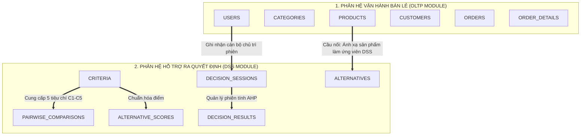
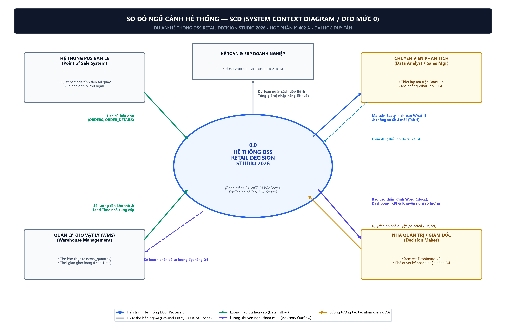
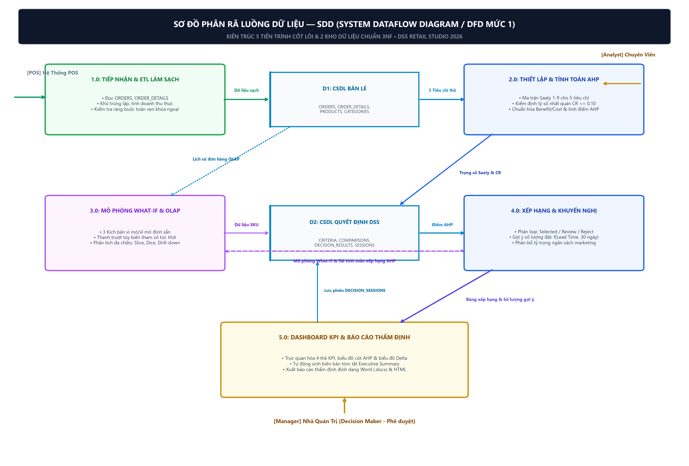
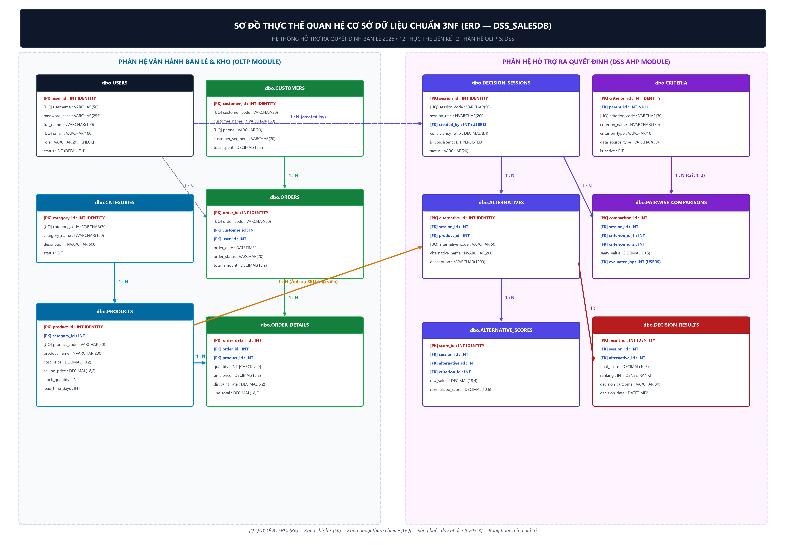

# DUY TÂN UNIVERSITY – INTERNATIONAL SCHOOL
## HỌC PHẦN: IS 402 A – HỆ THỐNG THÔNG TIN HỖ TRỢ RA QUYẾT ĐỊNH (DSS)
**Thời điểm nghiệm thu & phát hành: Tháng 10/2026**

---

# TÀI LIỆU THIẾT KẾ VÀ ĐẶC TẢ CƠ SỞ DỮ LIỆU CHUẨN 3NF & TỪ ĐIỂN DỮ LIỆU
### (RELATIONAL DATABASE SPECIFICATION & DATA DICTIONARY DOCUMENT)
**Cơ sở dữ liệu: `DSS_SalesDB` (Microsoft SQL Server 2022 / 2025 – 12 Bảng Thực Thể)**  
*Đề tài: Hệ Thống Hỗ Trợ Ra Quyết Định Chiến Lược Khuyến Mãi & Phân Bổ Hàng Hóa Quý 4/2026*  
*Phần mềm: DSS Retail Decision Studio 2026 (C# .NET 10.0 WinForms & SQL Server)*

* **Nhóm sinh viên thực hiện (Nhóm 05)**:
  1. **Trần Hồng Minh** *(Trưởng nhóm - MSSV: 29210247142)*
  2. **Lê Thị Nga** *(MSSV: 29206361029)*
  3. **Phạm Ngọc Tú** *(MSSV: 29204347819)*
  4. **Lê Thanh Diệu** *(MSSV: 29204622434)*
  5. **Hồ Thị Thuận** *(MSSV: 29201164457)*
* **Giảng viên hướng dẫn (Approved by)**: ThS. Nguyễn Quang Ánh

---

## 📌 MỤC LỤC TỔNG QUAN

- [PHẦN 1: TỔNG QUAN THIẾT KẾ CƠ SỞ DỮ LIỆU & KIẾN TRÚC LƯU TRỮ](#phần-1-tổng-quan-thiết-kế-cơ-sở-dữ-liệu--kiến-trúc-lưu-trữ)
  - [1.1. Mục tiêu và phạm vi thiết kế CSDL DSS_SalesDB](#11-mục-tiêu-và-phạm-vi-thiết-kế-csdl-dss_salesdb)
  - [1.2. Kiến trúc dữ liệu tích hợp hai phân hệ hữu cơ (OLTP & DSS)](#12-kiến-trúc-dữ-liệu-tích-hợp-hai-phân-hệ-hữu-cơ-oltp--dss)
  - [1.3. Mô hình ngữ cảnh dữ liệu (System Context Diagram - SCD / DFD Mức 0)](#13-mô-hình-ngữ-cảnh-dữ-liệu-system-context-diagram---scd--dfd-mức-0)
  - [1.4. Mô hình phân rã luồng dữ liệu (System Dataflow Diagram - SDD / DFD Mức 1)](#14-mô-hình-phân-rã-luồng-dữ-liệu-system-dataflow-diagram---sdd--dfd-mức-1)
- [PHẦN 2: MÔ HÌNH THỰC THỂ MỐI QUAN HỆ (ERD - ENTITY RELATIONSHIP DIAGRAM)](#phần-2-mô-hình-thực-thể-mối-quan-hệ-erd---entity-relationship-diagram)
  - [2.1. Danh mục 12 thực thể dữ liệu nghiệp vụ](#21-danh-mục-12-thực-thể-dữ-liệu-nghiệp-vụ)
  - [2.2. Sơ đồ thực thể mối quan hệ ERD trực quan](#22-sơ-đồ-thực-thể-mối-quan-hệ-erd-trực-quan)
  - [2.3. Ma trận mối quan hệ và bản số (Cardinality Matrix)](#23-ma-trận-mối-quan-hệ-và-bản-số-cardinality-matrix)
- [PHẦN 3: TỪ ĐIỂN DỮ LIỆU CHI TIẾT 12 BẢNG THỰC THỂ (DATA DICTIONARY)](#phần-3-từ-điển-dữ-liệu-chi-tiết-12-bảng-thực-thể-data-dictionary)
  - [3.1. Bảng dbo.USERS](#31-bảng-dbousers-quản-trị-người-dùng--phân-quyền-rbac)
  - [3.2. Bảng dbo.CATEGORIES](#32-bảng-dbocategories-danh-mục-ngành-hàng-bán-lẻ)
  - [3.3. Bảng dbo.PRODUCTS](#33-bảng-dboproducts-danh-mục-hàng-hóa--tồn-kho)
  - [3.4. Bảng dbo.CUSTOMERS](#34-bảng-dbocustomers-khách-hàng--phân-khúc-thị-trường)
  - [3.5. Bảng dbo.ORDERS](#35-bảng-dboorders-hóa-đơn-bán-lẻ-tổng-quát)
  - [3.6. Bảng dbo.ORDER_DETAILS](#36-bảng-dboorder_details-chi-tiết-hóa-đơn--cột-tính-toán)
  - [3.7. Bảng dbo.DECISION_SESSIONS](#37-bảng-dbodecision_sessions-phiên-thẩm-định--ra-quyết-định-dss)
  - [3.8. Bảng dbo.CRITERIA](#38-bảng-dbocriteria-cây-tiêu-chí-đánh-giá-saaty-ahp)
  - [3.9. Bảng dbo.ALTERNATIVES](#39-bảng-dboalternatives-danh-mục-sản-phẩm-ứng-viên-dss)
  - [3.10. Bảng dbo.PAIRWISE_COMPARISONS](#310-bảng-dbopairwise_comparisons-ma-trận-so-sánh-cặp-saaty)
  - [3.11. Bảng dbo.ALTERNATIVE_SCORES](#311-bảng-dboalternative_scores-điểm-đo-lường--chuẩn-hóa-tiêu-chí)
  - [3.12. Bảng dbo.DECISION_RESULTS](#312-bảng-dbodecision_results-kết-quả-xếp-hạng--khuyến-nghị-chung-cuộc)
- [PHẦN 4: TIẾN TRÌNH CHUẨN HÓA CƠ SỞ DỮ LIỆU (1NF ➔ 2NF ➔ 3NF)](#phần-4-tiến-trình-chuẩn-hóa-cơ-sở-dữ-liệu-1nf--2nf--3nf)
  - [4.1. Chuẩn hóa Dạng 1NF (Tính nguyên tử của dữ liệu)](#41-chuẩn-hóa-dạng-1nf-tính-nguyên-tử-của-dữ-liệu)
  - [4.2. Chuẩn hóa Dạng 2NF (Khử phụ thuộc hàm một phần)](#42-chuẩn-hóa-dạng-2nf-khử-phụ-thuộc-hàm-một-phần)
  - [4.3. Chuẩn hóa Dạng 3NF (Khử phụ thuộc hàm bắc cầu)](#43-chuẩn-hóa-dạng-3nf-khử-phụ-thuộc-hàm-bắc-cầu)
  - [4.4. Chứng minh tính đúng đắn và miễn nhiễm dị thường của CSDL 3NF](#44-chứng-minh-tính-đúng-đắn-và-miễn-nhiễm-dị-thường-của-csdl-3nf)
- [PHẦN 5: RÀNG BUỘC TOÀN VẸN, CHỈ MỤC & TỐI ƯU HIỆU NĂNG](#phần-5-ràng-buộc-toàn-vẹn-chỉ-mục--tối-ưu-hiệu-năng)
  - [5.1. Hệ thống ràng buộc nghiệp vụ (Domain CHECK Constraints)](#51-hệ-thống-ràng-buộc-nghiệp-vụ-domain-check-constraints)
  - [5.2. Danh mục 9 chỉ mục phi cụm tăng tốc truy vấn DSS & OLAP](#52-danh-mục-9-chỉ-mục-phi-cụm-tăng-tốc-truy-vấn-dss--olap)
  - [5.3. Chiến lược toàn vẹn tham chiếu (Referential Integrity & Cascade Rules)](#53-chiến-lược-toàn-vẹn-tham-chiếu-referential-integrity--cascade-rules)
- [PHẦN 6: TRUY VẤN NÂNG CAO & KHỐI PHÂN TÍCH ĐA CHIỀU OLAP](#phần-6-truy-vấn-nâng-cao--khối-phân-tích-đa-chiều-olap)
  - [6.1. View hiệu suất sản phẩm thực tế (vw_DSS_ProductPerformance)](#61-view-hiệu-suất-sản-phẩm-thực-tế-vw_dss_productperformance)
  - [6.2. Thuật toán AHP tích hợp trực tiếp bằng Common Table Expressions (CTE)](#62-thuật-toán-ahp-tích-hợp-trực-tiếp-bằng-common-table-expressions-cte)
  - [6.3. Khối lập phương OLAP ROLLUP phân cấp tồn kho](#63-khối-lập-phương-olap-rollup-phân-cấp-tồn-kho)
  - [6.4. Khối lập phương OLAP CUBE phân tích ma trận khuyến mãi](#64-khối-lập-phương-olap-cube-phân-tích-ma-trận-khuyến-mãi)
- [PHẦN 7: KẾT LUẬN & HƯỚNG DẪN BẢO TRÌ CƠ SỞ DỮ LIỆU](#phần-7-kết-luận--hướng-dẫn-bảo-trì-cơ-sở-dữ-liệu)

---

## 🖼️ DANH MỤC HÌNH ẢNH SƠ ĐỒ DỮ LIỆU

| Mã Hình | Tên Bản Vẽ Sơ Đồ Thiết Kế | Vị Trí Trong Báo Cáo |
| :---: | :--- | :---: |
| **Hình 1** | Sơ đồ Ngữ cảnh Hệ thống (SCD - System Context Diagram / DFD Mức 0) | [Mục 1.3](#13-mô-hình-ngữ-cảnh-dữ-liệu-system-context-diagram---scd--dfd-mức-0) |
| **Hình 2** | Sơ đồ Phân rã Luồng Dữ liệu (SDD - System Dataflow Diagram / DFD Mức 1) | [Mục 1.4](#14-mô-hình-phân-rã-luồng-dữ-liệu-system-dataflow-diagram---sdd--dfd-mức-1) |
| **Hình 3** | Sơ đồ Thực thể Mối quan hệ Chuẩn 3NF (ERD — DSS_SalesDB) | [Mục 2.2](#22-sơ-đồ-thực-thể-mối-quan-hệ-erd-trực-quan) |

---

## PHẦN 1: TỔNG QUAN THIẾT KẾ CƠ SỞ DỮ LIỆU & KIẾN TRÚC LƯU TRỮ

### 1.1. Mục tiêu và phạm vi thiết kế CSDL DSS_SalesDB
Cơ sở dữ liệu **`DSS_SalesDB`** là thành phần cốt lõi của phân hệ Quản lý dữ liệu (*Data Management Subsystem*) trong kiến trúc hệ hỗ trợ ra quyết định của Efraim Turban. Hệ thống phục vụ việc giải quyết bài toán:
> *"Lựa chọn Danh mục Sản phẩm Chiến lược để Phân bổ Ngân sách Nhập hàng & Tiếp thị Quý 4/2026."*

Các yêu cầu kỹ thuật nền tảng:
* **Hệ quản trị CSDL:** Microsoft SQL Server 2022 / 2025.
* **Chuẩn hóa quan hệ:** Đạt chuẩn hóa **3NF (Third Normal Form)** 100% trên toàn bộ 12 bảng thực thể.
* **Toàn vẹn dữ liệu:** Kiểm soát nghiêm ngặt ràng buộc miền giá trị thông qua các mệnh đề `CHECK`, khóa ngoại `FOREIGN KEY` và chỉ mục duy nhất `UNIQUE`.
* **Hỗ trợ phân tích đa chiều:** Tối ưu hóa cấu trúc để thực thi hiệu quả các câu truy vấn phức tạp `GROUP BY ROLLUP`, `GROUP BY CUBE` và Common Table Expressions (CTE).

---

### 1.2. Kiến trúc dữ liệu tích hợp hai phân hệ hữu cơ (OLTP & DSS)
Hệ thống gồm 12 bảng được phân chia thành 2 phân hệ có mối quan hệ liên kết mật thiết:



* **Phân hệ Vận hành Bán lẻ (OLTP):** 6 bảng (`USERS`, `CATEGORIES`, `PRODUCTS`, `CUSTOMERS`, `ORDERS`, `ORDER_DETAILS`) theo dõi đơn hàng, quản lý doanh thu, giá vốn và biến động tồn kho thực tế.
* **Phân hệ Ra quyết định (DSS):** 6 bảng (`DECISION_SESSIONS`, `CRITERIA`, `ALTERNATIVES`, `PAIRWISE_COMPARISONS`, `ALTERNATIVE_SCORES`, `DECISION_RESULTS`) quản lý phiên họp hội đồng, ma trận Saaty $5 \times 5$, chuẩn hóa Benefit/Cost và bảng xếp hạng quyết định chung cuộc.

---

### 1.3. Mô hình ngữ cảnh dữ liệu (System Context Diagram - SCD / DFD Mức 0)


*Hình 1: Sơ đồ Ngữ cảnh Hệ thống (SCD - System Context Diagram / DFD Mức 0)*

---

### 1.4. Mô hình phân rã luồng dữ liệu (System Dataflow Diagram - SDD / DFD Mức 1)


*Hình 2: Sơ đồ Phân rã Luồng Dữ liệu CSDL (SDD - System Dataflow Diagram / DFD Mức 1)*

---

## PHẦN 2: MÔ HÌNH THỰC THỂ MỐI QUAN HỆ (ERD - ENTITY RELATIONSHIP DIAGRAM)

### 2.1. Danh mục 12 thực thể dữ liệu nghiệp vụ

| STT | Thực Thể (Entity) | Phân Hệ | Số Cột | Vai Trò & Đóng Góp Trong Hệ Thống DSS |
| :---: | :--- | :---: | :---: | :--- |
| **1** | `dbo.USERS` | OLTP | 9 | Quản trị tài khoản, băm SHA-256 mật khẩu, phân quyền 4 vai trò RBAC. |
| **2** | `dbo.CATEGORIES` | OLTP | 5 | Phân loại ngành hàng: Smartphone, Laptop, Wearable, Phụ kiện. |
| **3** | `dbo.PRODUCTS` | OLTP | 11 | Hàng hóa kinh doanh, giá vốn, giá niêm yết, số lượng tồn kho, lead time. |
| **4** | `dbo.CUSTOMERS` | OLTP | 8 | Thông tin khách hàng, phân khúc thị trường (Retail, Wholesale, VIP). |
| **5** | `dbo.ORDERS` | OLTP | 9 | Hóa đơn bán hàng tổng quát: ngày bán, thu ngân, tổng tiền, chiết khấu. |
| **6** | `dbo.ORDER_DETAILS`| OLTP | 8 | Chi tiết từng dòng đơn hàng: số lượng bán, đơn giá, cột tính `line_total`. |
| **7** | `dbo.DECISION_SESSIONS`| DSS | 10 | Quản lý phiên quyết định, tỷ số nhất quán $CR$, cờ `is_consistent`. |
| **8** | `dbo.CRITERIA` | DSS | 8 | Cây tiêu chí đánh giá AHP 5 tiêu chí ($C_1 - C_5$), phân loại Benefit/Cost. |
| **9** | `dbo.ALTERNATIVES` | DSS | 6 | Danh mục 9 dòng sản phẩm ứng viên đưa vào phiên thẩm định DSS. |
| **10**| `dbo.PAIRWISE_COMPARISONS`| DSS | 7 | Ma trận so sánh cặp Saaty 1-9 (lưu dạng dọc nguyên tử $a_{ij}$ và $a_{ji}$). |
| **11**| `dbo.ALTERNATIVE_SCORES`| DSS | 6 | Điểm đo lường thô (`raw_value`) và điểm số chuẩn hóa (`normalized_score`). |
| **12**| `dbo.DECISION_RESULTS`| DSS | 7 | Điểm tổng hợp AHP, thứ hạng (`DENSE_RANK`) và nhãn phê duyệt chung cuộc. |

---

### 2.2. Sơ đồ thực thể mối quan hệ ERD trực quan


*Hình 3: Sơ đồ Thực thể Mối quan hệ Chuẩn 3NF (ERD — DSS_SalesDB)*

---

### 2.3. Ma trận mối quan hệ và bản số (Cardinality Matrix)

| Cặp Thực Thể Liên Kết | Bản Số | Diễn Giải Nghiệp Vụ Bán Lẻ & Hỗ Trợ Ra Quyết Định | Quy Tắc Toàn Vẹn Tham Chiếu |
| :--- | :---: | :--- | :--- |
| `CATEGORIES ➔ PRODUCTS` | $1 : N$ | Một ngành hàng chứa nhiều sản phẩm; mỗi sản phẩm chỉ thuộc 1 ngành hàng. | `ON DELETE NO ACTION` |
| `PRODUCTS ➔ ORDER_DETAILS`| $1 : N$ | Một sản phẩm xuất hiện trong nhiều đơn hàng; dòng chi tiết chỉ trỏ về 1 SKU. | `ON DELETE NO ACTION` |
| `CUSTOMERS ➔ ORDERS` | $1 : N$ | Một khách hàng mua nhiều đơn hàng; mỗi đơn hàng thuộc về một khách hàng. | `ON DELETE NO ACTION` |
| `ORDERS ➔ ORDER_DETAILS` | $1 : N$ | Một đơn hàng gồm nhiều mặt hàng; xóa đơn hàng sẽ tự động xóa chi tiết. | `ON DELETE CASCADE` |
| `USERS ➔ ORDERS` | $1 : N$ | Một thu ngân lập nhiều hóa đơn bán lẻ. | `ON DELETE NO ACTION` |
| `USERS ➔ DECISION_SESSIONS`| $1 : N$ | Một DecisionMaker chủ trì nhiều phiên thẩm định DSS (`created_by`). | `ON DELETE NO ACTION` |
| `PRODUCTS ➔ ALTERNATIVES` | $1 : N$ | **Cầu nối OLTP ➔ DSS:** Một sản phẩm được ánh xạ thành phương án ứng viên. | `ON DELETE NO ACTION` |
| `DECISION_SESSIONS ➔ ALTERNATIVES` | $1 : N$ | Một phiên ra quyết định đánh giá 9 phương án ứng viên. | `ON DELETE CASCADE` |
| `DECISION_SESSIONS ➔ PAIRWISE_COMPARISONS`| $1 : N$ | Một phiên sở hữu một ma trận so sánh cặp Saaty $5 \times 5$. | `ON DELETE CASCADE` |
| `CRITERIA ➔ PAIRWISE_COMPARISONS` | $1 : N \times 2$| Cặp so sánh liên kết với 2 tiêu chí (`criterion_id_1` và `criterion_id_2`). | `ON DELETE NO ACTION` |
| `ALTERNATIVES ➔ ALTERNATIVE_SCORES`| $1 : N$ | Một phương án có 5 bản ghi điểm số ứng với 5 tiêu chí đánh giá. | `ON DELETE CASCADE` |
| `ALTERNATIVES ➔ DECISION_RESULTS` | $1 : 1$ | Mỗi phương án trong phiên chỉ có duy nhất 1 kết quả xếp hạng chung cuộc. | `ON DELETE CASCADE` |

---

## PHẦN 3: TỪ ĐIỂN DỮ LIỆU CHI TIẾT 12 BẢNG THỰC THỂ (DATA DICTIONARY)

### 3.1. Bảng dbo.USERS (Quản Trị Người Dùng & Phân Quyền RBAC)
* **Mục đích:** Quản lý danh tính người dùng, phân quyền đăng nhập và băm mật khẩu bảo mật SHA-256.

| Tên Cột | Kiểu Dữ Liệu | NULL | Khóa | Mặc Định / Ràng Buộc | Diễn Giải Nghiệp Vụ |
| :--- | :--- | :---: | :---: | :--- | :--- |
| `user_id` | INT | NO | PK | IDENTITY(1,1) | Mã định danh duy nhất của người dùng. |
| `username` | VARCHAR(50) | NO | UQ | NOT NULL | Tên tài khoản đăng nhập (chống trùng lặp). |
| `password_hash` | VARCHAR(255) | NO | | NOT NULL | Mật khẩu đã băm bằng thuật toán SHA-256. |
| `full_name` | NVARCHAR(100) | NO | | NOT NULL | Họ và tên đầy đủ của cán bộ. |
| `email` | VARCHAR(100) | NO | UQ | NOT NULL | Thư điện tử doanh nghiệp (regex chuẩn). |
| `phone_number` | VARCHAR(20) | YES | | NULL | Số điện thoại liên lạc cá nhân. |
| `role` | VARCHAR(20) | NO | | CHECK in ('Admin', 'DecisionMaker', 'SalesManager', 'SalesStaff') | Vai trò phân quyền truy cập hệ thống. |
| `status` | BIT | NO | | DEFAULT 1 | Trạng thái (1: Đang hoạt động, 0: Bị khóa). |
| `created_at` | DATETIME2 | NO | | DEFAULT SYSDATETIME() | Thời điểm tạo tài khoản. |

---

### 3.2. Bảng dbo.CATEGORIES (Danh Mục Ngành Hàng Bán Lẻ)
* **Mục đích:** Phân loại 4 ngành hàng kinh doanh chính phục vụ gom nhóm phân tích.

| Tên Cột | Kiểu Dữ Liệu | NULL | Khóa | Mặc Định / Ràng Buộc | Diễn Giải Nghiệp Vụ |
| :--- | :--- | :---: | :---: | :--- | :--- |
| `category_id` | INT | NO | PK | IDENTITY(1,1) | Mã định danh ngành hàng. |
| `category_code` | VARCHAR(30) | NO | UQ | NOT NULL | Mã viết tắt (ví dụ: CAT_LAPTOP, CAT_PHONE). |
| `category_name` | NVARCHAR(100) | NO | | NOT NULL | Tên hiển thị ngành hàng kinh doanh. |
| `description` | NVARCHAR(500) | YES | | NULL | Mô tả đặc tính và phạm vi ngành hàng. |
| `status` | BIT | NO | | DEFAULT 1 | Trạng thái (1: Đang kinh doanh, 0: Ngừng). |

---

### 3.3. Bảng dbo.PRODUCTS (Danh Mục Hàng Hóa & Tồn Kho)
* **Mục đích:** Lưu trữ danh mục hàng hóa, giá vốn, giá bán, tồn kho. Đóng vai trò là nguồn dữ liệu ứng viên cho bài toán DSS.

| Tên Cột | Kiểu Dữ Liệu | NULL | Khóa | Mặc Định / Ràng Buộc | Diễn Giải Nghiệp Vụ |
| :--- | :--- | :---: | :---: | :--- | :--- |
| `product_id` | INT | NO | PK | IDENTITY(1,1) | Mã định danh sản phẩm. |
| `category_id` | INT | NO | FK | REFERENCES CATEGORIES(category_id) | Khóa ngoại trỏ về ngành hàng. |
| `product_code` | VARCHAR(50) | NO | UQ | NOT NULL | Mã SKU quản lý kho (ví dụ: PRD_ROG_G16). |
| `product_name` | NVARCHAR(200) | NO | | NOT NULL | Tên thương mại đầy đủ của thiết bị. |
| `cost_price` | DECIMAL(18,2) | NO | | CHECK (cost_price >= 0) | Giá vốn nhập khẩu đơn vị (VNĐ). |
| `selling_price`| DECIMAL(18,2) | NO | | CHECK (selling_price >= cost_price) | Giá bán niêm yết (bắt buộc $\ge$ Giá vốn). |
| `stock_quantity`| INT | NO | | DEFAULT 0, CHECK (stock_quantity >= 0) | Số lượng hàng thực tế trong kho. |
| `min_stock_level`| INT | NO | | DEFAULT 10 | Ngưỡng cảnh báo tồn kho an toàn tối thiểu. |
| `lead_time_days`| INT | NO | | DEFAULT 7 | Thời gian đặt hàng từ nhà sản xuất (ngày). |
| `is_active` | BIT | NO | | DEFAULT 1 | Trạng thái (1: Đang bán, 0: Ngừng bán). |
| `created_at` | DATETIME2 | NO | | DEFAULT SYSDATETIME() | Thời điểm thêm sản phẩm vào hệ thống. |

---

### 3.4. Bảng dbo.CUSTOMERS (Khách Hàng & Phân Khúc Thị Trường)
* **Mục đích:** Quản lý thông tin khách hàng và phân khúc thị trường phục vụ các truy vấn khối đa chiều OLAP CUBE.

| Tên Cột | Kiểu Dữ Liệu | NULL | Khóa | Mặc Định / Ràng Buộc | Diễn Giải Nghiệp Vụ |
| :--- | :--- | :---: | :---: | :--- | :--- |
| `customer_id` | INT | NO | PK | IDENTITY(1,1) | Mã định danh khách hàng. |
| `customer_code`| VARCHAR(30) | NO | UQ | NOT NULL | Mã khách hàng (ví dụ: CUST001). |
| `customer_name`| NVARCHAR(150) | NO | | NOT NULL | Tên cá nhân hoặc tổ chức mua lẻ. |
| `phone` | VARCHAR(20) | YES | UQ | NULL | Số điện thoại liên lạc chính. |
| `email` | VARCHAR(100) | YES | | NULL | Địa chỉ email liên hệ. |
| `address` | NVARCHAR(255) | YES | | NULL | Địa chỉ giao nhận hàng hóa. |
| `customer_segment`| VARCHAR(20) | NO | | CHECK in ('Retail', 'Wholesale', 'VIP') | Phân khúc khách hàng mua sắm. |
| `total_spent` | DECIMAL(18,2) | NO | | DEFAULT 0 | Tổng giá trị chi tiêu lũy kế (VNĐ). |

---

### 3.5. Bảng dbo.ORDERS (Hóa Đơn Bán Lẻ Tổng Quát)
* **Mục đích:** Quản lý hóa đơn bán hàng tổng quát: ngày bán, nhân viên thực hiện, tổng tiền và mức chiết khấu.

| Tên Cột | Kiểu Dữ Liệu | NULL | Khóa | Mặc Định / Ràng Buộc | Diễn Giải Nghiệp Vụ |
| :--- | :--- | :---: | :---: | :--- | :--- |
| `order_id` | INT | NO | PK | IDENTITY(1,1) | Mã số đơn hàng nội bộ. |
| `order_code` | VARCHAR(50) | NO | UQ | NOT NULL | Mã chứng từ hóa đơn (ví dụ: ORD-2026-0001). |
| `customer_id` | INT | NO | FK | REFERENCES CUSTOMERS(customer_id) | Khách hàng mua đơn hàng này. |
| `user_id` | INT | NO | FK | REFERENCES USERS(user_id) | Nhân viên thu ngân thực hiện hóa đơn. |
| `order_date` | DATETIME2 | NO | | DEFAULT SYSDATETIME() | Thời điểm xuất hóa đơn bán lẻ. |
| `order_status` | VARCHAR(20) | NO | | CHECK in ('Pending', 'Completed', 'Cancelled') | Trạng thái thanh toán của đơn hàng. |
| `total_amount` | DECIMAL(18,2) | NO | | DEFAULT 0 | Tổng tiền hàng trước chiết khấu (VNĐ). |
| `discount_amount`| DECIMAL(18,2) | NO | | DEFAULT 0 | Số tiền chiết khấu khuyến mãi (VNĐ). |
| `final_amount` | DECIMAL(18,2) | NO | | DEFAULT 0 | Tổng tiền thực thu từ khách hàng (VNĐ). |

---

### 3.6. Bảng dbo.ORDER_DETAILS (Chi Tiết Hóa Đơn & Cột Tính Toán)
* **Mục đích:** Lưu trữ chi tiết từng mặt hàng trong đơn hàng. Tích hợp cột tính toán `line_total` có thuộc tính `PERSISTED`.

| Tên Cột | Kiểu Dữ Liệu | NULL | Khóa | Mặc Định / Ràng Buộc | Diễn Giải Nghiệp Vụ |
| :--- | :--- | :---: | :---: | :--- | :--- |
| `order_detail_id`| INT | NO | PK | IDENTITY(1,1) | Mã định danh dòng chi tiết. |
| `order_id` | INT | NO | FK | REFERENCES ORDERS(order_id) ON DELETE CASCADE | Khóa ngoại trỏ về hóa đơn cha. |
| `product_id` | INT | NO | FK | REFERENCES PRODUCTS(product_id) | Khóa ngoại trỏ về sản phẩm bán ra. |
| `quantity` | INT | NO | | CHECK (quantity > 0) | Số lượng sản phẩm xuất bán ($> 0$). |
| `unit_price` | DECIMAL(18,2) | NO | | CHECK (unit_price >= 0) | Đơn giá bán thực tế tại thời điểm mua. |
| `unit_cost` | DECIMAL(18,2) | NO | | CHECK (unit_cost >= 0) | Đơn giá vốn xuất kho tại thời điểm mua. |
| `discount_rate`| DECIMAL(5,2) | NO | | DEFAULT 0, CHECK (0 <= rate <= 100) | Tỷ lệ giảm giá khuyến mãi (%). |
| `line_total` | DECIMAL(18,2) | NO | | AS ((qty*price)*(1-disc/100)) PERSISTED | Thành tiền dòng tính tự động và lưu vật lý. |

---

### 3.7. Bảng dbo.DECISION_SESSIONS (Phiên Thẩm Định & Ra Quyết Định DSS)
* **Mục đích:** Quản lý chu kỳ thẩm định kế hoạch nhập hàng Quý 4/2026, lưu trữ tỷ số nhất quán $CR$ và cờ kiểm định toán học.

| Tên Cột | Kiểu Dữ Liệu | NULL | Khóa | Mặc Định / Ràng Buộc | Diễn Giải Nghiệp Vụ |
| :--- | :--- | :---: | :---: | :--- | :--- |
| `session_id` | INT | NO | PK | IDENTITY(1,1) | Mã định danh phiên ra quyết định. |
| `session_code` | VARCHAR(50) | NO | UQ | NOT NULL | Mã phiên làm việc (ví dụ: SES_2026_Q4_RETAIL). |
| `session_title`| NVARCHAR(200) | NO | | NOT NULL | Tiêu đề phiên họp Hội đồng ra quyết định. |
| `description` | NVARCHAR(MAX) | YES | | NULL | Ghi chú mục tiêu chiến lược và bối cảnh. |
| `created_by` | INT | NO | FK | REFERENCES USERS(user_id) | Cán bộ chủ trì phiên (DecisionMaker). |
| `start_date` | DATETIME2 | NO | | DEFAULT SYSDATETIME() | Thời điểm bắt đầu phiên thẩm định. |
| `end_date` | DATETIME2 | YES | | NULL | Thời điểm chốt và ban hành quyết định. |
| `consistency_ratio`| DECIMAL(8,4)| YES | | NULL | Tỷ số nhất quán toán học $CR$ của Saaty. |
| `is_consistent`| BIT | NO | | AS (CASE WHEN CR <= 0.10 THEN 1 ELSE 0) PERSISTED | Cờ chỉ thị đạt chuẩn $CR \le 10\%$ tự động. |
| `status` | VARCHAR(20) | NO | | CHECK in ('Draft', 'Calculated', 'Approved', 'Rejected') | Trạng thái xử lý của phiên quyết định. |

---

### 3.8. Bảng dbo.CRITERIA (Cây Tiêu Chí Đánh Giá Saaty AHP)
* **Mục đích:** Quản lý 5 tiêu chí nghiệp vụ ($C_1 - C_5$), định nghĩa rõ loại tiêu chí (Benefit/Cost) để áp dụng hàm chuẩn hóa.

| Tên Cột | Kiểu Dữ Liệu | NULL | Khóa | Mặc Định / Ràng Buộc | Diễn Giải Nghiệp Vụ |
| :--- | :--- | :---: | :---: | :--- | :--- |
| `criterion_id` | INT | NO | PK | IDENTITY(1,1) | Mã định danh tiêu chí. |
| `parent_id` | INT | YES | FK | REFERENCES CRITERIA(criterion_id) | Hỗ trợ cấu trúc phân cấp thứ bậc đa tầng. |
| `criterion_code`| VARCHAR(30) | NO | UQ | NOT NULL | Mã tiêu chí (C1, C2, C3, C4, C5). |
| `criterion_name`| NVARCHAR(150) | NO | | NOT NULL | Tên tiêu chí (Biên LN, Doanh thu, Nhu cầu...). |
| `description` | NVARCHAR(500) | YES | | NULL | Định nghĩa và phương thức đo lường. |
| `criterion_type`| VARCHAR(10) | NO | | CHECK in ('Benefit', 'Cost') | Benefit (Lợi ích) / Cost (Chi phí/Rủi ro). |
| `data_source_type`| VARCHAR(30)| NO | | CHECK in ('Calculated_OLTP', 'Expert_Survey', 'Market_Data') | Nguồn trích xuất số liệu đầu vào. |
| `is_active` | BIT | NO | | DEFAULT 1 | Trạng thái áp dụng (1: Đang dùng, 0: Khóa). |

---

### 3.9. Bảng dbo.ALTERNATIVES (Danh Mục Sản Phẩm Ứng Viên DSS)
* **Mục đích:** Danh mục 9 phương án sản phẩm đưa vào phiên thẩm định AHP. Có khóa ngoại `product_id` liên kết sang bảng `PRODUCTS`.

| Tên Cột | Kiểu Dữ Liệu | NULL | Khóa | Mặc Định / Ràng Buộc | Diễn Giải Nghiệp Vụ |
| :--- | :--- | :---: | :---: | :--- | :--- |
| `alternative_id`| INT | NO | PK | IDENTITY(1,1) | Mã định danh phương án trong phiên. |
| `session_id` | INT | NO | FK | REFERENCES DECISION_SESSIONS(session_id) ON DELETE CASCADE | Khóa ngoại trỏ về phiên ra quyết định. |
| `product_id` | INT | YES | FK | REFERENCES PRODUCTS(product_id) | Khóa ngoại ánh xạ sang sản phẩm thực tế. |
| `alternative_code`| VARCHAR(50)| NO | | NOT NULL | Mã phương án (ví dụ: ALT_ROG_G16). |
| `alternative_name`| NVARCHAR(200)| NO | | NOT NULL | Tên phương án sản phẩm ứng viên. |
| `description` | NVARCHAR(1000)| YES | | NULL | Tóm tắt ưu nhược điểm kỹ thuật và thị phần. |

---

### 3.10. Bảng dbo.PAIRWISE_COMPARISONS (Ma Trận So Sánh Cặp Saaty)
* **Mục đích:** Lưu trữ ma trận so sánh cặp giữa 2 tiêu chí theo thang đo 1-9 của Saaty dưới dạng bảng dọc chuẩn 1NF.

| Tên Cột | Kiểu Dữ Liệu | NULL | Khóa | Mặc Định / Ràng Buộc | Diễn Giải Nghiệp Vụ |
| :--- | :--- | :---: | :---: | :--- | :--- |
| `comparison_id`| INT | NO | PK | IDENTITY(1,1) | Mã định danh bản ghi so sánh cặp. |
| `session_id` | INT | NO | FK | REFERENCES DECISION_SESSIONS(session_id) ON DELETE CASCADE | Khóa ngoại phiên ra quyết định. |
| `criterion_id_1`| INT | NO | FK | REFERENCES CRITERIA(criterion_id) | Tiêu chí dòng $i$ trong ma trận. |
| `criterion_id_2`| INT | NO | FK | REFERENCES CRITERIA(criterion_id) | Tiêu chí cột $j$ trong ma trận. |
| `saaty_value` | DECIMAL(10,5)| NO | | CHECK (saaty_value > 0) | Giá trị so sánh cặp $a_{ij}$ (Thang đo 1/9 đến 9). |
| `evaluation_notes`| NVARCHAR(255)| YES| | NULL | Lý do ưu tiên hoặc căn cứ chuyên gia. |
| `evaluated_by` | INT | NO | FK | REFERENCES USERS(user_id) | Chuyên gia hoặc cán bộ nhập điểm. |

---

### 3.11. Bảng dbo.ALTERNATIVE_SCORES (Điểm Đo Lường & Chuẩn Hóa Tiêu Chí)
* **Mục đích:** Lưu trữ điểm đo lường thực tế (`raw_value`) và điểm số đã được chuẩn hóa về đoạn $[0.0, 1.0]$ theo hàm Benefit/Cost.

| Tên Cột | Kiểu Dữ Liệu | NULL | Khóa | Mặc Định / Ràng Buộc | Diễn Giải Nghiệp Vụ |
| :--- | :--- | :---: | :---: | :--- | :--- |
| `score_id` | INT | NO | PK | IDENTITY(1,1) | Mã định danh bản ghi điểm. |
| `session_id` | INT | NO | FK | REFERENCES DECISION_SESSIONS(session_id) ON DELETE CASCADE | Khóa ngoại phiên ra quyết định. |
| `alternative_id`| INT | NO | FK | REFERENCES ALTERNATIVES(alternative_id) | Khóa ngoại trỏ về phương án ứng viên. |
| `criterion_id` | INT | NO | FK | REFERENCES CRITERIA(criterion_id) | Khóa ngoại trỏ về tiêu chí đánh giá. |
| `raw_value` | DECIMAL(18,4)| NO | | NOT NULL | Giá trị đo lường thô (%, Triệu đ, Ngày...). |
| `normalized_score`| DECIMAL(10,6)| NO | | CHECK (score >= 0.0 AND score <= 1.0) | Điểm chuẩn hóa trong không gian $[0.0, 1.0]$. |

---

### 3.12. Bảng dbo.DECISION_RESULTS (Kết Quả Xếp Hạng & Khuyến Nghị Chung Cuộc)
* **Mục đích:** Bảng kết quả cuối cùng: lưu điểm AHP tổng hợp, thứ vị xếp hạng (`DENSE_RANK`) và trạng thái phê duyệt.

| Tên Cột | Kiểu Dữ Liệu | NULL | Khóa | Mặc Định / Ràng Buộc | Diễn Giải Nghiệp Vụ |
| :--- | :--- | :---: | :---: | :--- | :--- |
| `result_id` | INT | NO | PK | IDENTITY(1,1) | Mã định danh bản ghi kết quả. |
| `session_id` | INT | NO | FK | REFERENCES DECISION_SESSIONS(session_id) ON DELETE CASCADE | Khóa ngoại phiên ra quyết định. |
| `alternative_id`| INT | NO | FK | REFERENCES ALTERNATIVES(alternative_id) | Khóa ngoại trỏ về phương án ứng viên. |
| `final_score` | DECIMAL(10,6)| NO | | CHECK (score >= 0.0 AND score <= 1.0) | Điểm AHP tổng hợp cuối cùng. |
| `ranking` | INT | NO | | CHECK (ranking > 0) | Thứ vị xếp hạng (1 đến 9). |
| `decision_outcome`| VARCHAR(30)| NO | | CHECK in ('Selected', 'UnderReview', 'Rejected') | Trạng thái phê duyệt chiến lược kinh doanh. |
| `decision_date`| DATETIME2 | NO | | DEFAULT SYSDATETIME() | Thời điểm chốt kết quả thẩm định. |

---

## PHẦN 4: TIẾN TRÌNH CHUẨN HÓA CƠ SỞ DỮ LIỆU (1NF ➔ 2NF ➔ 3NF)

### 4.1. Chuẩn hóa Dạng 1NF (Tính nguyên tử của dữ liệu)
* **Quy tắc:** Mỗi trường chỉ chứa duy nhất một giá trị nguyên tử (Atomic). Triệt tiêu hoàn toàn mảng giá trị (Repeating groups) và chuỗi ghép nối ký tự (Composite strings).
* **Áp dụng trong DSS_SalesDB:**
  * Bảng `PAIRWISE_COMPARISONS`: Thay vì lưu ma trận Saaty dạng mảng chuỗi hay JSON trong một ô dữ liệu của `DECISION_SESSIONS`, hệ thống phân rã thành các dòng nguyên tử độc lập. Mỗi bản ghi lưu đúng một cặp so sánh $(c_1, c_2, a_{ij})$.
  * Bảng `ORDER_DETAILS`: Phân rã từng món hàng trong đơn thành một dòng chi tiết riêng biệt, có khóa chính `order_detail_id` độc lập.

---

### 4.2. Chuẩn hóa Dạng 2NF (Khử phụ thuộc hàm một phần)
* **Quy tắc:** CSDL đã đạt chuẩn 1NF và mọi thuộc tính không khóa phải phụ thuộc hàm đầy đủ vào toàn bộ khóa chính, không phụ thuộc vào một phần khóa phức hợp.
* **Áp dụng trong DSS_SalesDB:**
  * Tại bảng `ORDER_DETAILS`: Nếu chọn khóa chính phức hợp là `(order_id, product_id)`, các thông tin như `product_name`, `cost_price`, `selling_price` chỉ phụ thuộc vào `product_id` chứ không phụ thuộc vào `order_id`. Do đó, toàn bộ các thuộc tính này được tách độc lập sang bảng `PRODUCTS`.
  * Tại bảng `ALTERNATIVE_SCORES`: Các thông tin của tiêu chí (`criterion_name`, `criterion_type`) được tách độc lập sang bảng `CRITERIA`, bảng điểm chỉ lưu `criterion_id`.

---

### 4.3. Chuẩn hóa Dạng 3NF (Khử phụ thuộc hàm bắc cầu)
* **Quy tắc:** CSDL đã đạt chuẩn 2NF và không tồn tại bất kỳ phụ thuộc hàm bắc cầu nào giữa các thuộc tính không khóa ($X \to Y$ và $Y \to Z$).
* **Áp dụng trong DSS_SalesDB:**
  * Tại bảng `PRODUCTS`: Ta có phụ thuộc $product\_id \to category\_id$. Nếu lưu thêm $category\_name$ trong `PRODUCTS` thì sẽ xảy ra phụ thuộc bắc cầu: $product\_id \to category\_id \to category\_name$. Hệ thống đã triệt tiêu hoàn toàn thuộc tính này khỏi `PRODUCTS` và chuẩn hóa độc lập tại `CATEGORIES`.
  * Tại bảng `ORDERS`: Phụ thuộc $order\_id \to customer\_id \to customer\_name, customer\_segment$. Thông tin khách hàng được tách riêng 100% sang `CUSTOMERS`.

> [!TIP]
> **Kết luận chuẩn hóa 3NF:** Toàn bộ 12 bảng trong cơ sở dữ liệu `DSS_SalesDB` đều thỏa mãn nguyên lý chuẩn hóa của E.F. Codd: *"Mọi thuộc tính phi khóa đều phụ thuộc trực tiếp vào Khóa chính, toàn bộ Khóa chính, và không gì khác ngoài Khóa chính"*. CSDL hoàn toàn miễn nhiễm với các dị thường thêm (Insertion), xóa (Deletion) và cập nhật (Update).

---

## PHẦN 5: RÀNG BUỘC TOÀN VẸN, CHỈ MỤC & TỐI ƯU HIỆU NĂNG

### 5.1. Hệ thống ràng buộc nghiệp vụ (Domain CHECK Constraints)
* `CK_Products_SellingPrice`: `selling_price >= cost_price` $\to$ Đảm bảo không bao giờ bán dưới giá vốn.
* `CK_Products_StockQuantity`: `stock_quantity >= 0` $\to$ Tồn kho vật lý không bao giờ âm.
* `CK_OrderDetails_Quantity`: `quantity > 0` $\to$ Đơn hàng phải có số lượng dương.
* `CK_AltScores_Normalized`: `normalized_score >= 0.0 AND normalized_score <= 1.0` $\to$ Điểm chuẩn hóa AHP luôn nằm trong đoạn $[0, 1]$.
* `CK_Pairwise_SaatyValue`: `saaty_value > 0` $\to$ Giá trị so sánh cặp Saaty bắt buộc là số thực dương.

---

### 5.2. Danh mục 9 chỉ mục phi cụm tăng tốc truy vấn DSS & OLAP

| Tên Chỉ Mục (Index Name) | Bảng & Cột Được Đánh Chỉ Mục | Mục Đích Tối Ưu Hóa & Lợi Ích Hiệu Năng |
| :--- | :--- | :--- |
| `IX_Products_CategoryId` | `dbo.PRODUCTS (category_id)` | Tối ưu hóa phép JOIN giữa bảng ngành hàng và sản phẩm. |
| `IX_Orders_CustomerId` | `dbo.ORDERS (customer_id)` | Tối ưu hóa truy vấn lịch sử mua sắm theo từng khách hàng. |
| `IX_Orders_OrderDate` | `dbo.ORDERS (order_date)` | Tăng tốc lọc dữ liệu bán lẻ theo khoảng thời gian Quý 4/2026. |
| `IX_OrderDetails_ProductId`| `dbo.ORDER_DETAILS (product_id)` | Tăng tốc tổng hợp doanh thu và sản lượng bán theo từng SKU. |
| `IX_OrderDetails_OrderId` | `dbo.ORDER_DETAILS (order_id)` | Tăng tốc trích xuất chi tiết đơn lẻ khi in hóa đơn bán hàng. |
| `IX_Alternatives_SessionId`| `dbo.ALTERNATIVES (session_id)` | Tăng tốc nạp danh mục 9 sản phẩm ứng viên của phiên DSS. |
| `IX_Pairwise_SessionId` | `dbo.PAIRWISE_COMPARISONS (session_id)`| Tăng tốc trích xuất ma trận Saaty $5 \times 5$ tính trọng số. |
| `IX_AltScores_SessionId` | `dbo.ALTERNATIVE_SCORES (session_id)` | Tăng tốc nạp bảng điểm đa tiêu chí phục vụ nhân ma trận. |
| `IX_Results_SessionRanking`| `dbo.DECISION_RESULTS (session_id, ranking)`| Tối ưu hóa sắp xếp và hiển thị bảng xếp hạng Hạng 1-9. |

---

### 5.3. Chiến lược toàn vẹn tham chiếu (Referential Integrity & Cascade Rules)
* Các bảng chi tiết thuộc phiên làm việc DSS (`ALTERNATIVES`, `PAIRWISE_COMPARISONS`, `ALTERNATIVE_SCORES`, `DECISION_RESULTS`) đều được cấu hình `ON DELETE CASCADE` trỏ về `DECISION_SESSIONS`. Khi người dùng hủy hoặc xóa một phiên nháp, toàn bộ ma trận và điểm số liên quan được dọn dẹp sạch sẽ trong 1 transaction, không để lại dữ liệu mồ côi (Orphan records).
* Ngược lại, quan hệ giữa `CATEGORIES` ➔ `PRODUCTS` và `PRODUCTS` ➔ `ORDER_DETAILS` áp dụng `ON DELETE NO ACTION` để bảo vệ lịch sử chứng từ kế toán, chống việc vô tình xóa sản phẩm làm mất dữ liệu hóa đơn cũ.

---

## PHẦN 6: TRUY VẤN NÂNG CAO & KHỐI PHÂN TÍCH ĐA CHIỀU OLAP

### 6.1. View hiệu suất sản phẩm thực tế (vw_DSS_ProductPerformance)
```sql
CREATE OR ALTER VIEW dbo.vw_DSS_ProductPerformance AS
SELECT 
    p.product_id,
    p.product_code,
    p.product_name,
    c.category_name,
    p.cost_price,
    p.selling_price,
    CAST(((p.selling_price - p.cost_price) / p.selling_price) * 100.0 AS DECIMAL(5,2)) AS gross_margin_pct,
    p.stock_quantity,
    ISNULL(SUM(od.quantity), 0) AS total_sold_qty,
    ISNULL(SUM(od.line_total), 0) AS actual_revenue,
    ISNULL(SUM(od.line_total - (od.quantity * od.unit_cost)), 0) AS actual_profit
FROM dbo.PRODUCTS p
INNER JOIN dbo.CATEGORIES c ON p.category_id = c.category_id
LEFT JOIN dbo.ORDER_DETAILS od ON p.product_id = od.product_id
GROUP BY p.product_id, p.product_code, p.product_name, c.category_name, p.cost_price, p.selling_price, p.stock_quantity;
```

---

### 6.2. Thuật toán AHP tích hợp trực tiếp bằng Common Table Expressions (CTE)
```sql
WITH WeightCalculated AS (
    SELECT pc.criterion_id_1 AS criterion_id,
           AVG(pc.saaty_value / col_sums.col_sum) AS criterion_weight
    FROM dbo.PAIRWISE_COMPARISONS pc
    INNER JOIN (
        SELECT criterion_id_2, SUM(saaty_value) AS col_sum
        FROM dbo.PAIRWISE_COMPARISONS WHERE session_id = 1 GROUP BY criterion_id_2
    ) col_sums ON pc.criterion_id_2 = col_sums.criterion_id_2
    WHERE pc.session_id = 1 GROUP BY pc.criterion_id_1
),
AltScores AS (
    SELECT s.alternative_id, SUM(w.criterion_weight * s.normalized_score) AS comp_score
    FROM dbo.ALTERNATIVE_SCORES s
    INNER JOIN WeightCalculated w ON s.criterion_id = w.criterion_id
    WHERE s.session_id = 1 GROUP BY s.alternative_id
),
Ranked AS (
    SELECT alternative_id, comp_score,
           DENSE_RANK() OVER (ORDER BY comp_score DESC) as rk
    FROM AltScores
)
MERGE dbo.DECISION_RESULTS AS target
USING Ranked AS source
ON (target.session_id = 1 AND target.alternative_id = source.alternative_id)
WHEN MATCHED THEN
    UPDATE SET target.final_score = source.comp_score,
               target.ranking = source.rk,
               target.decision_outcome = CASE WHEN source.rk = 1 THEN 'Selected' WHEN source.comp_score >= 0.60 THEN 'UnderReview' ELSE 'Rejected' END,
               target.decision_date = SYSDATETIME();
```

---

### 6.3. Khối lập phương OLAP ROLLUP phân cấp tồn kho
```sql
SELECT 
    CASE WHEN GROUPING(c.category_name) = 1 THEN N'-- TẤT CẢ NGÀNH HÀNG --' ELSE c.category_name END AS [Ngành Hàng],
    CASE WHEN GROUPING(p.product_name) = 1 THEN N'-- TỔNG CỘNG NHÓM --' ELSE p.product_name END AS [Sản Phẩm],
    SUM(p.stock_quantity) AS [Tổng Tồn Kho],
    ISNULL(SUM(od.quantity), 0) AS [Tổng Đã Bán],
    FORMAT(ISNULL(SUM(od.line_total), 0), '#,##0') + N' đ' AS [Doanh Thu],
    CASE 
        WHEN SUM(p.stock_quantity) > 100 AND ISNULL(SUM(od.quantity), 0) < 20 
        THEN N'⚠️ NGUY CƠ ĐỌNG VỐN: ĐỀ XUẤT GIẢM GIÁ KHUYẾN MÃI'
        WHEN SUM(p.stock_quantity) < 15 
        THEN N'⚡ SẮP CHÁY HÀNG: CẦN PHÂN BỔ NHẬP THÊM'
        ELSE N'✅ CÂN BẰNG TỒN KHO'
    END AS [Khuyến Nghị Phân Bổ DSS]
FROM dbo.CATEGORIES c
INNER JOIN dbo.PRODUCTS p ON c.category_id = p.category_id
LEFT JOIN dbo.ORDER_DETAILS od ON p.product_id = od.product_id
GROUP BY ROLLUP(c.category_name, p.product_name);
```

---

### 6.4. Khối lập phương OLAP CUBE phân tích ma trận khuyến mãi
```sql
SELECT 
    ISNULL(cust.customer_segment, N'-- TẤT CẢ PHÂN KHÚC --') AS [Phân Khúc],
    ISNULL(cat.category_name, N'-- TẤT CẢ NGÀNH HÀNG --') AS [Ngành Hàng],
    COUNT(DISTINCT o.order_id) AS [Số Đơn Hàng],
    FORMAT(ISNULL(SUM(od.line_total), 0), '#,##0') + N' đ' AS [Doanh Thu],
    CASE 
        WHEN cust.customer_segment = 'VIP' THEN N'Tặng Voucher Tri Ân 10% & Dịch Vụ Đặc Quyền'
        WHEN cust.customer_segment = 'Retail' AND ISNULL(SUM(od.quantity), 0) < 5 THEN N'Áp Dụng Khuyến Mãi Mua 1 Tặng 1 Để Kích Cầu'
        ELSE N'Duy Trì Giá Chuẩn'
    END AS [Chiến Lược Khuyến Mãi Gợi Ý]
FROM dbo.CUSTOMERS cust
INNER JOIN dbo.ORDERS o ON cust.customer_id = o.customer_id
INNER JOIN dbo.ORDER_DETAILS od ON o.order_id = od.order_id
INNER JOIN dbo.PRODUCTS p ON od.product_id = p.product_id
INNER JOIN dbo.CATEGORIES cat ON p.category_id = cat.category_id
GROUP BY CUBE(cust.customer_segment, cat.category_name);
```

---

## PHẦN 7: KẾT LUẬN & HƯỚNG DẪN BẢO TRÌ CƠ SỞ DỮ LIỆU

Cơ sở dữ liệu **`DSS_SalesDB`** là thành quả phân tích, thiết kế chuẩn mực của Nhóm 05 trong học phần **IS 402 A**. CSDL đáp ứng trọn vẹn cả hai yêu cầu: tính toàn vẹn của một hệ thống giao dịch bán lẻ hiện đại (OLTP) và tính linh hoạt, tốc độ cao của bộ máy tính toán hỗ trợ ra quyết định đa tiêu chí (DSS AHP).

### Kế Hoạch Sao Lưu & Phục Hồi Dữ Liệu:
* **Sao lưu toàn phần (Full Backup lúc 23:00):**
  ```sql
  BACKUP DATABASE DSS_SalesDB TO DISK = 'D:\Backup\DSS_SalesDB_Full.bak' WITH INIT, COMPRESSION;
  ```
* **Sao lưu vi sai (Differential Backup lúc 12:00):**
  ```sql
  BACKUP DATABASE DSS_SalesDB TO DISK = 'D:\Backup\DSS_SalesDB_Diff.bak' WITH DIFFERENTIAL;
  ```
* **Phục hồi thảm họa (Disaster Recovery):**
  ```sql
  RESTORE DATABASE DSS_SalesDB FROM DISK = 'D:\Backup\DSS_SalesDB_Full.bak' WITH REPLACE;
  ```

### Thông Tin Đội Ngũ Thực Hiện:
* **Nhóm 05 – Lớp IS 402 A** – Khoa Hệ thống Thông tin Quản lý (MIS) – Trường Đào tạo Quốc tế – Đại học Duy Tân.
* **Thành viên:** Trần Hồng Minh (Trưởng nhóm), Lê Thị Nga, Phạm Ngọc Tú, Lê Thanh Diệu, Hồ Thị Thuận.
* **Giảng viên hướng dẫn:** ThS. Nguyễn Quang Ánh.
