# DUY TÂN UNIVERSITY – INTERNATIONAL SCHOOL
## HỌC PHẦN: IS 402 A – HỆ THỐNG THÔNG TIN HỖ TRỢ RA QUYẾT ĐỊNH (DSS)
**Thời điểm nghiệm thu & phát hành: Tháng 10/2026**

---

# TÀI LIỆU THIẾT KẾ BẢN VẼ WIREFRAME & ĐẶC TẢ GIAO DIỆN NGƯỜI DÙNG
### (GUI SPECIFICATION & WIREFRAME DESIGN DOCUMENT)
**Hệ thống Hỗ trợ Ra Quyết định Chiến lược Khuyến mãi & Phân bổ Hàng hóa**  
*Phần mềm: DSS Retail Decision Studio 2026 (C# .NET 10.0 WinForms, AHP Saaty & SQL Server DSS_SalesDB)*

* **Nhóm sinh viên thực hiện (Nhóm 05)**:
  1. **Trần Hồng Minh** *(Trưởng nhóm - MSSV: 29210247142)*
  2. **Lê Thị Nga** *(MSSV: 29206361029)*
  3. **Phạm Ngọc Tú** *(MSSV: 29204347819)*
  4. **Lê Thanh Diệu** *(MSSV: 29204622434)*
  5. **Hồ Thị Thuận** *(MSSV: 29201164457)*
* **Giảng viên hướng dẫn (Approved by)**: ThS. Nguyễn Quang Ánh

---

## 📌 MỤC LỤC TỔNG QUAN

- [PHẦN 1: TỔNG QUAN THIẾT KẾ GIAO DIỆN & TRẢI NGHIỆM NGƯỜI DÙNG (UI/UX)](#phần-1-tổng-quan-thiết-kế-giao-diện--trải-nghiệm-người-dùng-uiux)
  - [1.1. Mục tiêu và phạm vi tài liệu](#11-mục-tiêu-và-phạm-vi-tài-liệu)
  - [1.2. Triết lý thiết kế trực quan hóa DSS (Human-Centered Design)](#12-triết-lý-thiết-kế-trực-quan-hóa-dss-human-centered-design)
  - [1.3. Hệ thống tiêu chuẩn thiết kế (Design System & UI Tokens)](#13-hệ-thống-tiêu-chuẩn-thiết-kế-design-system--ui-tokens)
  - [1.4. Sơ đồ luồng di chuyển màn hình (Screen Flow & Navigation Architecture)](#14-sơ-đồ-luồng-di-chuyển-màn-hình-screen-flow--navigation-architecture)
- [PHẦN 2: ĐẶC TẢ CHI TIẾT BẢN VẼ WIREFRAME & CÁC MÀN HÌNH CHỨC NĂNG](#phần-2-đặc-tả-chi-tiết-bản-vẽ-wireframe--các-màn-hình-chức-năng)
  - [2.1. GUI-01: Màn hình Khởi động & Kiểm tra CSDL (Splash Screen Form)](#21-gui-01-màn-hình-khởi-động--kiểm-tra-csdl-splash-screen-form)
  - [2.2. GUI-02: Màn hình Đăng nhập & Xác thực Bảo mật SHA-256 (Login Form)](#22-gui-02-màn-hình-đăng-nhập--xác-thực-bảo-mật-sha-256-login-form)
  - [2.3. GUI-03: Màn hình Đăng ký Tài khoản Người dùng Mới (Register Form)](#23-gui-03-màn-hình-đăng-ký-tài-khoản-người-dùng-mới-register-form)
  - [2.4. GUI-04: Màn hình Chính - Tab 1: Đầu Vào Dữ Liệu & Ma Trận Saaty 5x5](#24-gui-04-màn-hình-chính---tab-1-đầu-vào-dữ-liệu--ma-trận-saaty-5x5)
  - [2.5. GUI-05: Màn hình Chính - Tab 2: Kết Quả Ra Quyết Định & Xếp Hạng DSS](#25-gui-05-màn-hình-chính---tab-2-kết-quả-ra-quyết-định--xếp-hạng-dss)
  - [2.6. GUI-06: Màn hình Chính - Tab 3: Mô Phỏng Biến Động Thị Trường What-If](#26-gui-06-màn-hình-chính---tab-3-mô-phỏng-biến-động-thị-trường-what-if)
  - [2.7. GUI-07: Màn hình Chính - Tab 4: Thêm Sản Phẩm Mới & Thẩm Định Động](#27-gui-07-màn-hình-chính---tab-4-thêm-sản-phẩm-mới--thẩm-định-động)
  - [2.8. GUI-08: Màn hình Chính - Tab 5: Dữ Liệu Bán Hàng Lịch Sử & OLAP Engine](#28-gui-08-màn-hình-chính---tab-5-dữ-liệu-bán-hàng-lịch-sử--olap-engine)
  - [2.9. GUI-09: Màn hình Chính - Tab 6: Biểu Mẫu Báo Cáo Thẩm Định & Phê Duyệt](#29-gui-09-màn-hình-chính---tab-6-biểu-mẫu-báo-cáo-thẩm-định--phê-duyệt)
  - [2.10. GUI-10: Màn hình Khóa An Toàn Khi Mất Kết Nối CSDL (DatabaseGuard Overlay)](#210-gui-10-màn-hình-khóa-an-toàn-khi-mất-kết-nối-csdl-databaseguard-overlay)
- [PHẦN 3: MA TRẬN ÁNH XẠ GIAO DIỆN VỚI USE CASE & NGHIỆP VỤ (TRACEABILITY MATRIX)](#phần-3-ma-trận-ánh-xạ-giao-diện-với-use-case--nghiệp-vụ-traceability-matrix)
- [PHẦN 4: ĐÁNH GIÁ CÔNG THÁI HỌC VÀ TIÊU CHUẨN USABILITY (HEURISTIC EVALUATION)](#phần-4-đánh-giá-công-thái-học-và-tiêu-chuẩn-usability-heuristic-evaluation)
- [PHẦN 5: KẾT LUẬN & HƯỚNG DẪN NGHIỆM THU GIAO DIỆN (ACCEPTANCE CHECKLIST)](#phần-5-kết-luận--hướng-dẫn-nghiệm-thu-giao-diện-acceptance-checklist)

---

## PHẦN 1: TỔNG QUAN THIẾT KẾ GIAO DIỆN & TRẢI NGHIỆM NGƯỜI DÙNG (UI/UX)

### 1.1. Mục tiêu và phạm vi tài liệu
Tài liệu **"Thiết Kế Bản Vẽ Wireframe & Đặc Tả Giao Diện Người Dùng"** là hồ sơ kỹ thuật chi tiết nhằm chuyển đổi các yêu cầu phân tích chức năng (BFD, Use Case, Flowchart) của học phần **IS 402 A** thành các bản vẽ thiết kế giao diện đồ họa (Wireframe) và bảng đặc tả thành phần tương tác (UI Components Specification) cho phần mềm **DSS Retail Decision Studio 2026**.

**Phạm vi đặc tả:**
* 100% các màn hình tương tác của ứng dụng máy trạm C# .NET 10.0 WinForms (Splash Screen, Login, Register, Main Dashboard 6 Tabs và Modal Security Overlay).
* Định nghĩa rõ ràng Control Name/ID trong mã nguồn C#, kiểu điều khiển, nhãn hiển thị, sự kiện kích hoạt, ràng buộc nghiệp vụ (validation) và cơ chế phân quyền truy cập theo vai trò (RBAC).

---

### 1.2. Triết lý thiết kế trực quan hóa DSS (Human-Centered Design)
Giao diện của hệ thống được xây dựng dựa trên 3 nền tảng lý thuyết cốt lõi:
1. **8 Quy tắc vàng của Ben Shneiderman (Eight Golden Rules of Interface Design):**
   * *Tính nhất quán (Consistency):* Thống nhất bảng màu Slate Navy / Indigo, font chữ Segoe UI, và cấu trúc dạng thẻ Card trên toàn bộ hệ thống.
   * *Hỗ trợ phím tắt & Phản hồi nhanh:* Cho phép dùng phím Enter để đăng nhập, phím Esc để thoát, và cung cấp 4 phím 1-click chọn nhanh tài khoản kiểm thử.
   * *Phản hồi có ý nghĩa (Informative Feedback):* Mọi thao tác kích hoạt DSS, áp dụng kịch bản What-If hay lưu SKU mới đều đi kèm hộp thoại thông báo và đèn báo trạng thái rõ ràng.
   * *Thiết kế chu trình hoàn chỉnh:* Tổ chức 6 Tab theo đúng trình tự tư duy ra quyết định của nhà quản trị: *Dữ liệu đầu vào ➔ Ra quyết định ➔ Phân tích độ nhạy ➔ Thẩm định động ➔ Khai phá OLAP ➔ Ban hành báo cáo*.
   * *Phòng ngừa lỗi chủ động (Error Prevention):* Tự động khóa ô nhập biên lợi nhuận C1, chặn tính điểm khi $CR > 10\%$, và tự động khóa toàn bộ giao diện khi phát hiện ngắt kết nối CSDL.
2. **Quy tắc 3-Click (Three-Click Rule):**
   * Nhà quản lý có thể tiếp cận kết quả xếp hạng tối ưu và xuất báo cáo thẩm định chỉ trong tối đa 3 lần nhấp chuột từ khi đăng nhập.
3. **Tháp kiến trúc DSS của Efraim Turban:**
   * Giao diện người dùng (*Dialog System*) đóng vai trò cây cầu kết nối trực quan giữa Nhà ra quyết định (*Decision Maker*), Kho dữ liệu đa chiều (*Data Warehouse / OLAP*) và Bộ máy mô hình toán học (*Model Base / AHP Engine*).

---

### 1.3. Hệ thống tiêu chuẩn thiết kế (Design System & UI Tokens)

#### 🎨 Bảng mã màu chuẩn hóa (Color Palette Tokens):
| Tên Token & Mã Màu | Màu Sắc Đại Diện | Phạm Vi Ứng Dụng Trong Hệ Thống DSS | Ý Nghĩa Công Thái Học |
| :--- | :---: | :--- | :--- |
| **Slate Navy Deep** (`#0F172A`) | Nền tối sang trọng | Header, Title Bar, Tiêu đề DataGridView, Splash Screen | Tạo cảm giác vững chãi, bảo mật cao cấp |
| **Indigo Primary** (`#4F46E5`) | Xanh chàm công nghệ | Nút "CHẠY MÔ HÌNH DSS NGAY", Nút Đăng nhập, Tab Active | Nút hành động chính (Primary Action), thu hút thị giác |
| **Emerald Success** (`#10B981`) | Xanh ngọc bảo lục | Huy hiệu CR ≤ 10%, Quyết định Selected, Nút Lưu SKU | Trạng thái an toàn, phương án tối ưu được phê duyệt |
| **Amber Warning** (`#F59E0B`) | Vàng cam hổ phách | Huy hiệu Hạng 1 Gold, Trạng thái UnderReview, Kịch bản Gaming | Báo hiệu cần chú ý, xem xét kỹ lưỡng trước khi giải ngân |
| **Rose Danger** (`#E11D48`) | Đỏ hồng cảnh báo | Trạng thái Rejected, Nút Đăng xuất, Kịch bản Đứt gãy cung ứng | Cảnh báo rủi ro cao, xả tồn kho hoặc ngắt kết nối mạng |
| **Slate Canvas** (`#F8FAFC`) | Trắng xám dịu mắt | Nền canvas chính của Form và các Tab chức năng | Độ tương phản cao với chữ đậm, không gây mỏi mắt |

#### 🔤 Hệ thống Typography (Segoe UI):
* **Cấp 1 - Tiêu đề ứng dụng & Form:** `14pt - 18pt Bold`
* **Cấp 2 - Tiêu đề phân khu / Thẻ Card:** `10.5pt - 11.5pt Bold`
* **Cấp 3 - Nhãn trường nhập liệu:** `9.5pt Bold`
* **Cấp 4 - Nội dung bảng biểu & văn bản:** `8.5pt - 9.5pt Regular`
* **Cấp 5 - Chú giải phụ & Ghi chú SQL:** `7.5pt - 8.5pt Italic`

---

### 1.4. Sơ đồ luồng di chuyển màn hình (Screen Flow & Navigation Architecture)

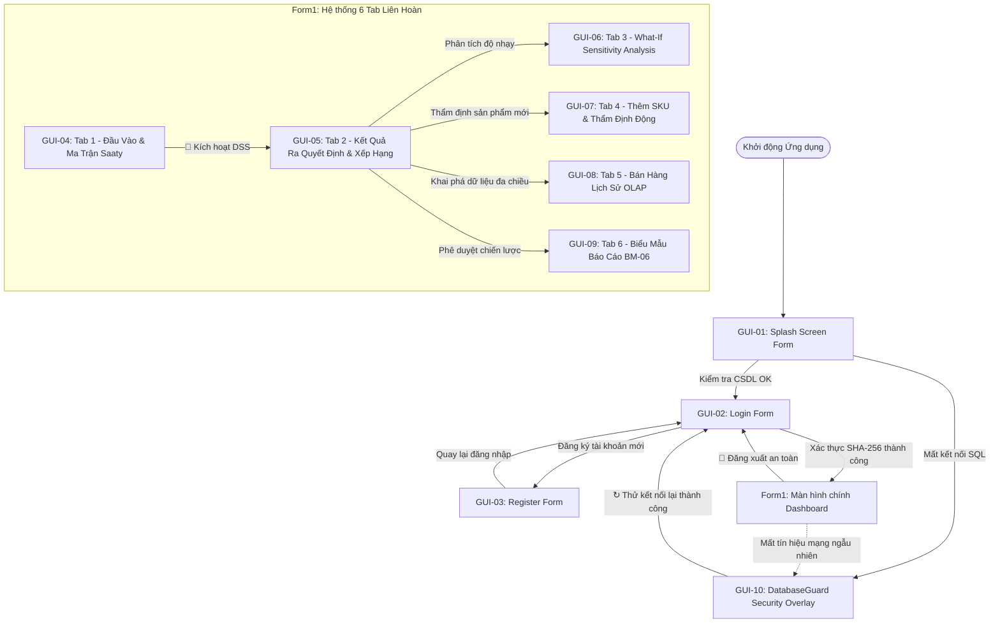

---

## PHẦN 2: ĐẶC TẢ CHI TIẾT BẢN VẼ WIREFRAME & CÁC MÀN HÌNH CHỨC NĂNG

---

### 2.1. GUI-01: Màn hình Khởi động & Kiểm tra CSDL (Splash Screen Form)

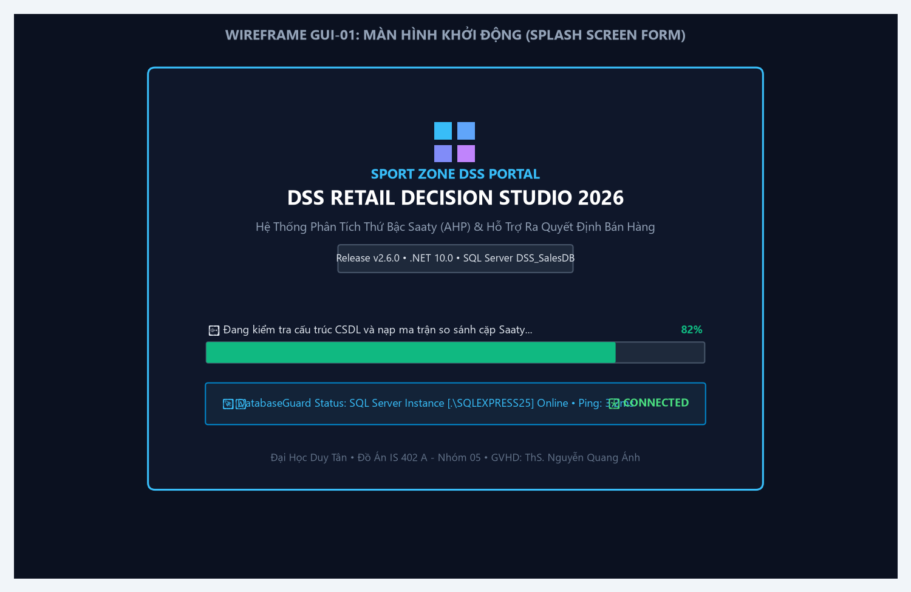
*Hình 1: Bản vẽ Wireframe Màn hình Khởi động (Splash Screen Form - GUI-01)*

#### 📋 Mô tả nghiệp vụ:
Màn hình xuất hiện ngay khi kích hoạt phần mềm; tự động gọi module `DatabaseGuard.Ping()` để kiểm tra kết nối tới instance `.\SQLEXPRESS25` (database `DSS_SalesDB`), kiểm tra toàn vẹn bảng ma trận AHP và hiển thị thanh tiến trình tải tài nguyên mượt mà.

#### ⚙️ Bảng đặc tả thành phần giao diện GUI-01:
| STT | Tên Control ID | Loại Control | Nhãn / Giá Trị Hiển Thị | Ràng Buộc & Thuộc Tính Kỹ Thuật | Sự Kiện Kích Hoạt | Phân Quyền |
| :---: | :--- | :--- | :--- | :--- | :--- | :---: |
| **1** | `SplashForm` | Form | DSS Retail Decision Studio 2026 | `BorderStyle=None`, `CenterScreen`, 680x470px | `Load`, `Shown` | All |
| **2** | `pnlLogoBadge` | Panel | 4 khối vuông màu sắc (GDI+) | Đại diện cho 4 chiều thông tin DSS | `Paint` | All |
| **3** | `lblAppTitle` | Label | DSS RETAIL DECISION STUDIO 2026 | Font `Segoe UI 16pt Bold`, màu trắng tuyết | Static | All |
| **4** | `lblVersion` | Label | Release v2.6.0 Enterprise (.NET 10.0) | Khung bo góc nền tối viền xám | Static | All |
| **5** | `progressBar` | ProgressBar | Tăng từ 0% đến 100% | `Style=Continuous`, màu Emerald `#10B981` | `Timer.Tick` | All |
| **6** | `lblLoadingStatus`| Label | Đang nạp CSDL và kiểm tra ma trận... | Font `Segoe UI 8.5pt`, text động theo từng bước | Dynamic | All |
| **7** | `pnlDbStatusBox` | Panel | DatabaseGuard: Online • Ping: 3.2ms | Đèn báo trạng thái kết nối SQL Server | `Ping Result` | All |
| **8** | `timerSplash` | Timer | `Interval = 35ms` | Điều khiển bước nhảy progress bar và ping DB | `Tick` | All |

---

### 2.2. GUI-02: Màn hình Đăng nhập & Xác thực Bảo mật SHA-256 (Login Form)

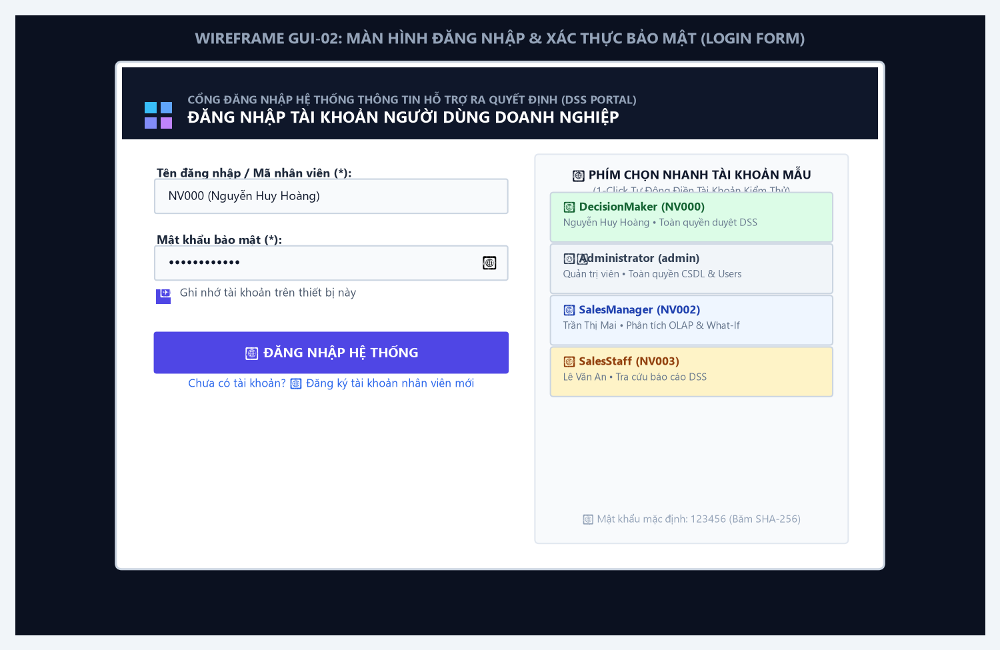
*Hình 2: Bản vẽ Wireframe Màn hình Đăng nhập (Login Form - GUI-02)*

#### 📋 Mô tả nghiệp vụ:
Xác thực người dùng truy cập phần mềm bằng tài khoản và mật khẩu băm mã hóa SHA-256 đối chiếu với bảng `dbo.USERS`. Hỗ trợ bật/tắt hiển thị mật khẩu, ghi nhớ phiên làm việc và tích hợp 4 nút 1-click chọn nhanh tài khoản kiểm thử cho 4 vai trò.

#### ⚙️ Bảng đặc tả thành phần giao diện GUI-02:
| STT | Tên Control ID | Loại Control | Nhãn / Giá Trị Hiển Thị | Ràng Buộc & Thuộc Tính Kỹ Thuật | Sự Kiện Kích Hoạt | Phân Quyền |
| :---: | :--- | :--- | :--- | :--- | :--- | :---: |
| **1** | `headerPanel` | Panel | CỔNG ĐĂNG NHẬP DSS PORTAL | Panel tự vẽ GDI+, nền Slate Navy `#0F172A` | `Paint` | All |
| **2** | `txtUsername` | TextBox | NV000 | Bắt buộc nhập, độ dài 3-50 ký tự | `KeyDown (Enter)` | All |
| **3** | `txtPassword` | TextBox | •••••••••••• | `UseSystemPasswordChar=True`, độ dài ≥ 6 ký tự | `KeyDown (Enter)` | All |
| **4** | `btnToggleEye` | Label | 👁 (Icon ẩn/hiện) | Nhấp để đổi trạng thái ẩn/hiện mật khẩu | `Click` | All |
| **5** | `chkRemember` | CheckBox | Ghi nhớ tài khoản trên máy này | Lưu mã nhân viên vào bộ nhớ tạm ứng dụng | `CheckedChanged` | All |
| **6** | `btnLogin` | Button | 🔐 ĐĂNG NHẬP HỆ THỐNG | Màu Indigo `#4F46E5`, kích hoạt xác thực SHA-256 | `Click` | All |
| **7** | `lnkRegister` | LinkLabel | Chưa có tài khoản? 👉 Đăng ký mới | Mở màn hình `RegisterForm` | `LinkClicked` | All |
| **8** | `btnDemoNV000` | Button | 👑 DecisionMaker: NV000 (Hoàng) | Tự động điền tài khoản Người ra quyết định | `Click` | All |
| **9** | `btnDemoAdmin` | Button | ⚙️ Administrator: admin (Hệ thống) | Tự động điền tài khoản Quản trị CSDL | `Click` | All |
| **10**| `btnDemoNV002` | Button | 📊 SalesManager: NV002 (Mai) | Tự động điền tài khoản Trưởng phòng Phân tích | `Click` | All |
| **11**| `btnDemoNV003` | Button | 💼 SalesStaff: NV003 (An) | Tự động điền tài khoản Chuyên viên bán hàng | `Click` | All |

---

### 2.3. GUI-03: Màn hình Đăng ký Tài khoản Người dùng Mới (Register Form)

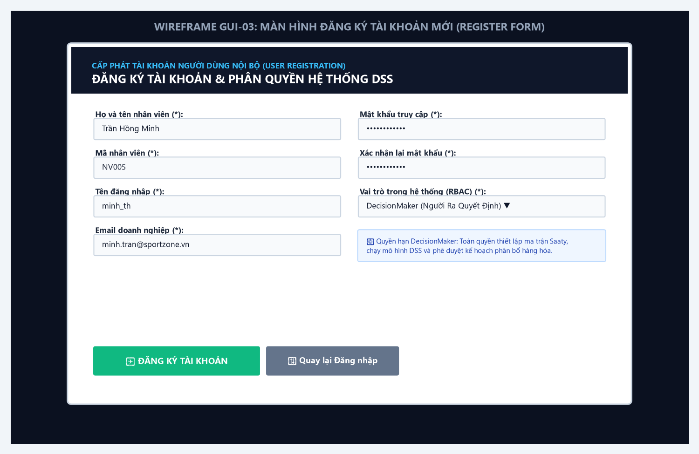
*Hình 3: Bản vẽ Wireframe Màn hình Đăng ký Tài khoản (Register Form - GUI-03)*

#### 📋 Mô tả nghiệp vụ:
Màn hình cho phép khởi tạo tài khoản nhân viên mới trong tổ chức; thực hiện kiểm tra định dạng email regex, độ dài mật khẩu và phân bổ vai trò quyền hạn tương ứng trong bảng `dbo.USERS`.

#### ⚙️ Bảng đặc tả thành phần giao diện GUI-03:
| STT | Tên Control ID | Loại Control | Nhãn / Giá Trị Hiển Thị | Ràng Buộc & Thuộc Tính Kỹ Thuật | Sự Kiện Kích Hoạt | Phân Quyền |
| :---: | :--- | :--- | :--- | :--- | :--- | :---: |
| **1** | `txtFullName` | TextBox | Họ và tên nhân viên (*) | Bắt buộc nhập, độ dài 2-100 ký tự | `Validating` | All |
| **2** | `txtEmpCode` | TextBox | Mã nhân viên (*) | Định dạng chuẩn NVxxx (ví dụ: NV005) | `Validating` | All |
| **3** | `txtRegUsername` | TextBox | Tên đăng nhập (*) | Độ dài 4-30 ký tự, kiểm tra không được trùng | `Validating` | All |
| **4** | `txtEmail` | TextBox | Email doanh nghiệp (*) | Định dạng regex email chuẩn doanh nghiệp | `Validating` | All |
| **5** | `txtRegPassword` | TextBox | Mật khẩu truy cập (*) | Tối thiểu 6 ký tự, UseSystemPasswordChar | `TextChanged` | All |
| **6** | `txtConfirmPass` | TextBox | Xác nhận lại mật khẩu (*) | Bắt buộc khớp 100% với mật khẩu ở trên | `Validating` | All |
| **7** | `cboRole` | ComboBox | Vai trò phân quyền (RBAC) (*)| Danh sách: DecisionMaker, Admin, SalesManager, SalesStaff | `SelectedIndex` | Admin/Mgr |
| **8** | `btnRegister` | Button | ✅ ĐĂNG KÝ TÀI KHOẢN | Màu xanh Emerald `#10B981`, kiểm tra toàn vẹn form | `Click` | All |
| **9** | `btnBackLogin` | Button | ↩ Quay lại Đăng nhập | Đóng form đăng ký và hiển thị lại LoginForm | `Click` | All |

---

### 2.4. GUI-04: Màn hình Chính - Tab 1: Đầu Vào Dữ Liệu & Ma Trận Saaty 5x5

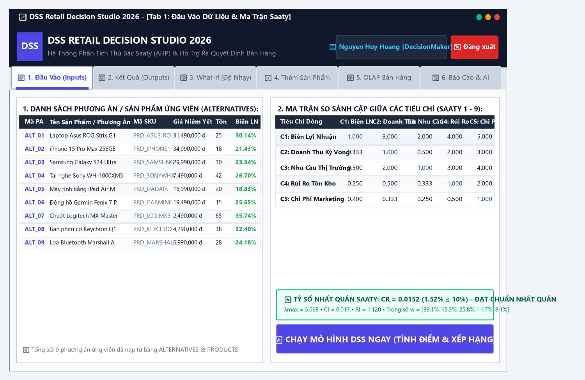
*Hình 4: Bản vẽ Wireframe Tab 1 - Đầu Vào Dữ Liệu & Ma Trận Saaty (GUI-04)*

#### 📋 Mô tả nghiệp vụ:
Bố cục dạng SplitContainer chia đôi màn hình: Cột trái quản lý danh mục 9 dòng sản phẩm ứng viên (`ALTERNATIVES`), Cột phải là Ma trận so sánh cặp Saaty 5 tiêu chí nghiệp vụ. Hệ thống tự động tính toán Eigenvector và kiểm tra điều kiện nhất quán $CR \le 0.10$ theo thời gian thực.

#### ⚙️ Bảng đặc tả thành phần giao diện GUI-04:
| STT | Tên Control ID | Loại Control | Nhãn / Giá Trị Hiển Thị | Ràng Buộc & Thuộc Tính Kỹ Thuật | Sự Kiện Kích Hoạt | Phân Quyền |
| :---: | :--- | :--- | :--- | :--- | :--- | :---: |
| **1** | `splitInput` | SplitContainer | Tỉ lệ 52% Trái - 48% Phải | `SplitterWidth=8px`, tự động co giãn theo cửa sổ | `Resize` | All |
| **2** | `dgvInputAlternatives` | DataGridView | Danh sách 9 sản phẩm ứng viên | 7 cột: Mã PA, Tên Phương Án, SKU, Giá Vốn, Giá Bán, Tồn, Biên LN | `DataSource` | All |
| **3** | `dgvInputMatrix` | DataGridView | Ma trận so sánh cặp Saaty 5x5 | 6 cột: Tiêu chí dòng, C1, C2, C3, C4, C5 (thang đo 1-9) | `CellValueChanged` | DecisionMaker |
| **4** | `lblInputMatrixStatus` | Label | 🟢 Tỷ số CR = 0.0152 (1.52% ≤ 10%) | Xanh lá khi CR ≤ 10%, Đỏ rực khi CR > 10% | `UpdateMatrixStatus` | All |
| **5** | `btnRunFromTab1` | Button | 🚀 CHẠY MÔ HÌNH DSS NGAY | Màu Indigo `#4F46E5`, dock góc phải thanh trạng thái | `Click` | DecisionMaker/Admin |

> [!IMPORTANT]
> **Cơ chế chống sai lỗi toán học Saaty**: Khi $CR > 0.10$, nhãn trạng thái chuyển đỏ cảnh báo và nút *"CHẠY MÔ HÌNH DSS NGAY"* sẽ bị chặn thực thi để ngăn ngừa việc ra quyết định trên ma trận mâu thuẫn logic.

---

### 2.5. GUI-05: Màn hình Chính - Tab 2: Kết Quả Ra Quyết Định & Xếp Hạng DSS

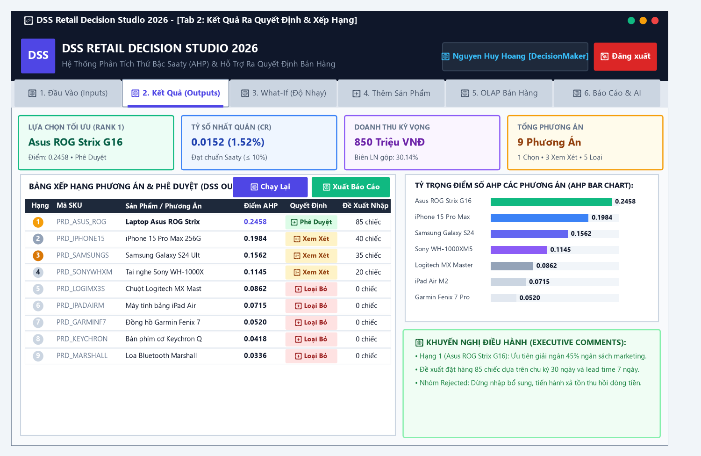
*Hình 5: Bản vẽ Wireframe Tab 2 - Kết Quả Ra Quyết Định & Xếp Hạng DSS (GUI-05)*

#### 📋 Mô tả nghiệp vụ:
Trình diễn toàn diện kết quả giải bài toán DSS: 4 Thẻ KPI điều hành trên đỉnh, Cột trái là bảng DataGridView xếp hạng chi tiết có vẽ huy hiệu tròn Hạng 1-3 và pill trạng thái phê duyệt; Cột phải gồm Biểu đồ cột tỷ trọng điểm số AHP và Hộp khuyến nghị điều hành (*Executive Comments*).

#### ⚙️ Bảng đặc tả thành phần giao diện GUI-05:
| STT | Tên Control ID | Loại Control | Nhãn / Giá Trị Hiển Thị | Ràng Buộc & Thuộc Tính Kỹ Thuật | Sự Kiện Kích Hoạt | Phân Quyền |
| :---: | :--- | :--- | :--- | :--- | :--- | :---: |
| **1** | `lblCardRank1Val` | Label (KPI 1) | Asus ROG Strix G16 | Thẻ Lựa Chọn Hàng Đầu: Điểm 0.2458 • Phê Duyệt | `UpdateOutputView` | All |
| **2** | `lblCardCRVal` | Label (KPI 2) | 0.0152 (1.52%) | Thẻ Tỷ Số Nhất Quán: Đạt chuẩn Saaty ≤ 10% | `UpdateOutputView` | All |
| **3** | `lblCardRevenueVal` | Label (KPI 3) | 850 Triệu VNĐ | Thẻ Doanh Thu Kỳ Vọng: Biên lợi nhuận 30.14% | `UpdateOutputView` | All |
| **4** | `lblCardCandidatesVal` | Label (KPI 4) | 9 Phương Án | Thẻ Tổng Số: 1 Chọn • 3 Xem Xét • 5 Loại Bỏ | `UpdateOutputView` | All |
| **5** | `dgvRanking` | DataGridView | Bảng xếp hạng phương án DSS | 8 cột: Hạng, SKU, Phương Án, Giá Bán, Điểm AHP, Quyết Định, Đề Xuất | `CellPainting` | All |
| **6** | `btnRerunDSS` | Button | 🔄 Chạy Lại Mô Hình | Tái tính toán tức thời sau khi cập nhật dữ liệu | `Click` | DecisionMaker/Admin |
| **7** | `btnExportReport` | Button | 📄 Xuất Biên Bản Báo Cáo | Màu xanh Emerald, mở module xuất báo cáo thẩm định | `Click` | Manager/Analyst |
| **8** | `ahpChartPanel` | Panel | Biểu đồ cột tỷ trọng điểm AHP | Vẽ GDI+ tự động co giãn hiển thị 9 cột điểm AHP | `Paint` | All |
| **9** | `lblAdvisoryContent`| Label | Hộp khuyến nghị điều hành | Tự động sinh văn bản nhận xét chiến lược kinh doanh | `Dynamic` | All |

---

### 2.6. GUI-06: Màn hình Chính - Tab 3: Mô Phỏng Biến Động Thị Trường What-If

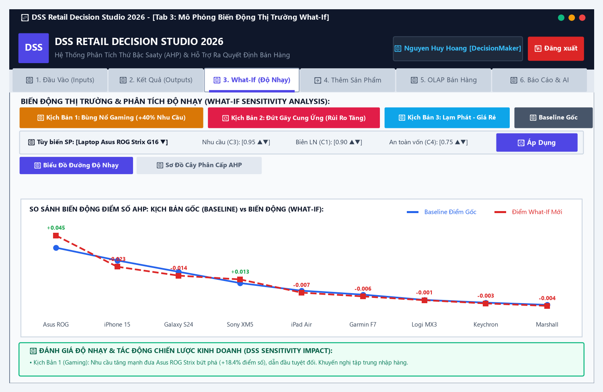
*Hình 6: Bản vẽ Wireframe Tab 3 - Mô Phỏng Biến Động Thị Trường What-If (GUI-06)*

#### 📋 Mô tả nghiệp vụ:
Thực hiện phân tích độ nhạy (Sensitivity Analysis): Người dùng kích hoạt 3 kịch bản vĩ mô định sẵn hoặc tùy chỉnh các tham số vi mô (Nhu cầu C3, Biên LN C1, An toàn vốn C4) trên từng sản phẩm. Hệ thống tái chuẩn hóa in-memory và trực quan hóa sự dịch chuyển điểm số bằng Biểu đồ đường đối chiếu (*Delta Chart*) hoặc Sơ đồ cây phân cấp AHP.

#### ⚙️ Bảng đặc tả thành phần giao diện GUI-06:
| STT | Tên Control ID | Loại Control | Nhãn / Giá Trị Hiển Thị | Ràng Buộc & Thuộc Tính Kỹ Thuật | Sự Kiện Kích Hoạt | Phân Quyền |
| :---: | :--- | :--- | :--- | :--- | :--- | :---: |
| **1** | `btnScenarioGaming` | Button | 🔥 Kịch Bản 1: Bùng Nổ Gaming | Tăng +40% nhu cầu thị trường cho laptop và phụ kiện | `Click` | Analyst/Manager |
| **2** | `btnScenarioSupplyCrisis` | Button | ⚡ Kịch Bản 2: Đứt Gãy Cung Ứng | Tăng gấp đôi rủi ro tồn kho (C4), kéo dài lead time | `Click` | Analyst/Manager |
| **3** | `btnScenarioInflation`| Button | 📉 Kịch Bản 3: Lạm Phát Giá Rẻ | Ưu tiên các dòng máy giá rẻ, giảm sức mua máy cao cấp | `Click` | Analyst/Manager |
| **4** | `btnScenarioReset` | Button | 🔄 Khôi Phục Dữ Liệu Gốc | Xóa bỏ các tham số mô phỏng, hoàn nguyên Baseline | `Click` | All |
| **5** | `cboWhatIfProduct` | ComboBox | Danh sách 9 sản phẩm | Chọn SKU cần điều chỉnh thông số vi mô | `SelectedIndex` | Analyst |
| **6** | `numWhatIfDemand` | NumericUpDown | Nhu cầu (C3): 0.05 - 1.00 | Thanh trượt bước nhảy 0.05 điều chỉnh nhu cầu | `ValueChanged` | Analyst |
| **7** | `numWhatIfProfit` | NumericUpDown | Biên LN (C1): 0.05 - 1.00 | Thanh trượt điều chỉnh giả định mức tỷ suất lợi nhuận | `ValueChanged` | Analyst |
| **8** | `numWhatIfRisk` | NumericUpDown | An toàn vốn (C4): 0.05 - 1.00 | Thanh trượt điều chỉnh rủi ro vốn và thời gian hoàn vốn | `ValueChanged` | Analyst |
| **9** | `btnApplyCustomWhatIf`| Button | ⚡ Áp Dụng Tham Số | Tái chuẩn hóa ma trận và tính lại điểm AHP tức thời | `Click` | Analyst |
| **10**| `btnViewDeltaChart` | Button | 📈 Biểu Đồ Đường Độ Nhạy | Kích hoạt chế độ vẽ đồ thị đường Delta Line Chart | `Click` | All |
| **11**| `btnViewHierarchyTree`| Button | 🌳 Sơ Đồ Cây Phân Cấp AHP | Kích hoạt chế độ vẽ cây thứ bậc Saaty 3 tầng có mũi tên | `Click` | All |
| **12**| `whatIfDiagramPanel` | Panel | Vùng canvas vẽ trực quan | Tự vẽ đồ thị Delta Chart hoặc Cây phân cấp AHP GDI+ | `Paint` | All |
| **13**| `lblWhatIfAdvisory` | Label | Đánh giá độ nhạy chiến lược | Đưa ra phân tích tự động về sự đảo chiều của Rank 1 | `Dynamic` | All |

---

### 2.7. GUI-07: Màn hình Chính - Tab 4: Thêm Sản Phẩm Mới & Thẩm Định Động

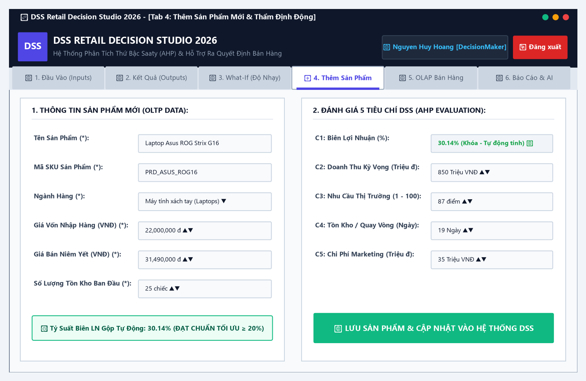
*Hình 7: Bản vẽ Wireframe Tab 4 - Thêm Sản Phẩm Mới & Thẩm Định Động (GUI-07)*

#### 📋 Mô tả nghiệp vụ:
Bố cục 2 Thẻ đối xứng: Thẻ 1 quản lý thông tin sản phẩm bán lẻ OLTP, Thẻ 2 thu thập điểm số 5 tiêu chí DSS AHP. Hệ thống tự động tính toán Biên lợi nhuận ($C_1$) từ Giá bán và Giá vốn theo thời gian thực và khóa cứng ô nhập $C_1$ để chống sai lệch dữ liệu. Khi bấm Lưu, hệ thống tự động ghi đồng thời vào bảng `PRODUCTS` và `ALTERNATIVES`, sau đó kích hoạt tính lại phiên DSS ngay lập tức.

#### ⚙️ Bảng đặc tả thành phần giao diện GUI-07:
| STT | Tên Control ID | Loại Control | Nhãn / Giá Trị Hiển Thị | Ràng Buộc & Thuộc Tính Kỹ Thuật | Sự Kiện Kích Hoạt | Phân Quyền |
| :---: | :--- | :--- | :--- | :--- | :--- | :---: |
| **1** | `txtProductName` | TextBox | Tên Sản Phẩm (*) | Độ dài 3-150 ký tự (ví dụ: Laptop Asus ROG Strix G16) | `Validating` | Analyst/Admin |
| **2** | `txtProductCode` | TextBox | Mã SKU (*) | Định dạng chuẩn PRD_xxx, tự ánh xạ sang ALT_xxx | `Validating` | Analyst/Admin |
| **3** | `cboCategory` | ComboBox | Ngành Hàng (*) | 4 ngành: Điện thoại, Laptop, Wearable, Phụ kiện | `SelectedIndex` | Analyst/Admin |
| **4** | `numCostPrice` | NumericUpDown | Giá Vốn (VNĐ) (*) | 0 - 200,000,000 đ, bước nhảy 500,000 đ | `ValueChanged` | Analyst/Admin |
| **5** | `numSellingPrice`| NumericUpDown | Giá Bán Niêm Yết (*) | Bắt buộc Giá bán ≥ Giá vốn, bước nhảy 500,000 đ | `ValueChanged` | Analyst/Admin |
| **6** | `lblCalculatedMargin`| Label | Biên LN: 30.14% (Tối Ưu) | Tự động tính: ((Giá Bán - Giá Vốn)/Giá Bán)*100% | `Auto Update` | All |
| **7** | `numStock` | NumericUpDown | Tồn Kho Ban Đầu (*) | Khoảng giá trị: 0 - 10,000 đơn vị | `ValueChanged` | Analyst/Admin |
| **8** | `txtAutoMarginC1` | TextBox | C1: Biên Lợi Nhuận | `ReadOnly=True`, tự động điền từ tỷ suất lợi nhuận | `Locked` | All |
| **9** | `numExpectedRevenue`| NumericUpDown| C2: Doanh Thu Kỳ Vọng | Đơn vị: Triệu VNĐ, khoảng giá trị 0 - 10,000 | `ValueChanged` | Analyst/Admin |
| **10**| `numMarketDemand` | NumericUpDown | C3: Nhu Cầu Thị Trường | Thang đo định lượng: 1 - 100 điểm | `ValueChanged` | Analyst/Admin |
| **11**| `numInventoryDays` | NumericUpDown | C4: Tồn Kho / Vòng Quay | Thời gian hoàn vốn dự kiến: 1 - 365 ngày (Cost) | `ValueChanged` | Analyst/Admin |
| **12**| `numMarketingCost` | NumericUpDown | C5: Chi Phí Marketing | Ngân sách tiếp thị dự kiến: 0 - 1,000 Triệu đ (Cost) | `ValueChanged` | Analyst/Admin |
| **13**| `btnSaveAndRank` | Button | 💾 LƯU SẢN PHẨM & CẬP NHẬT | Màu xanh Emerald, ghi DB và kích hoạt chạy lại DSS | `Click` | Analyst/Admin |

---

### 2.8. GUI-08: Màn hình Chính - Tab 5: Dữ Liệu Bán Hàng Lịch Sử & OLAP Engine

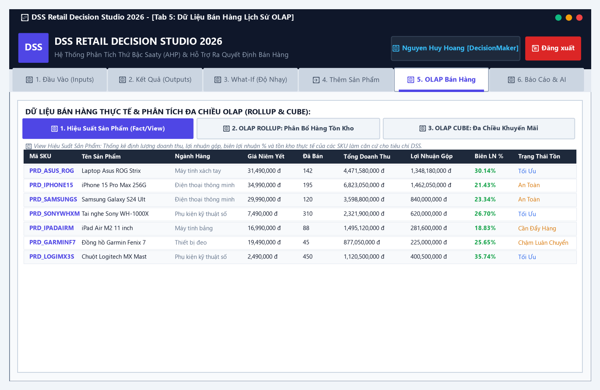
*Hình 8: Bản vẽ Wireframe Tab 5 - Dữ Liệu Bán Hàng Lịch Sử OLAP (GUI-08)*

#### 📋 Mô tả nghiệp vụ:
Khai phá dữ liệu bán hàng đa chiều qua 3 nút truy vấn chuyên biệt: View hiệu suất sản phẩm thực tế, Truy vấn phân cấp hàng tồn kho `GROUP BY ROLLUP` và Ma trận phân khúc khách hàng `GROUP BY CUBE` phục vụ lập kế hoạch xúc tiến thương mại.

#### ⚙️ Bảng đặc tả thành phần giao diện GUI-08:
| STT | Tên Control ID | Loại Control | Nhãn / Giá Trị Hiển Thị | Ràng Buộc & Thuộc Tính Kỹ Thuật | Sự Kiện Kích Hoạt | Phân Quyền |
| :---: | :--- | :--- | :--- | :--- | :--- | :---: |
| **1** | `btnViewSales` | Button | 📊 1. Hiệu Suất Sản Phẩm | Truy vấn `vw_DSS_ProductPerformance`: Doanh thu, lãi gộp, tồn | `Click` | All |
| **2** | `btnViewRollup` | Button | 📦 2. OLAP ROLLUP: Tồn Kho | `GROUP BY ROLLUP(c.category_name, p.product_name)` | `Click` | Analyst/Manager |
| **3** | `btnViewCube` | Button | 🎯 3. OLAP CUBE: Khuyến Mãi | `GROUP BY CUBE(cust.customer_segment, cat.category_name)` | `Click` | Analyst/Manager |
| **4** | `lblOlapDescription`| Label | 💡 Chú giải thuật toán SQL | Hiển thị giải thích câu lệnh SQL Server tương ứng đang chạy | `Dynamic` | All |
| **5** | `dgvSales` | DataGridView | Bảng dữ liệu bán hàng OLAP | Đa cột: Mã SKU, Tên SP, Ngành Hàng, Giá, Đã Bán, Doanh Thu, Biên LN | `DataSource` | All |

---

### 2.9. GUI-09: Màn hình Chính - Tab 6: Biểu Mẫu Báo Cáo Thẩm Định & Phê Duyệt

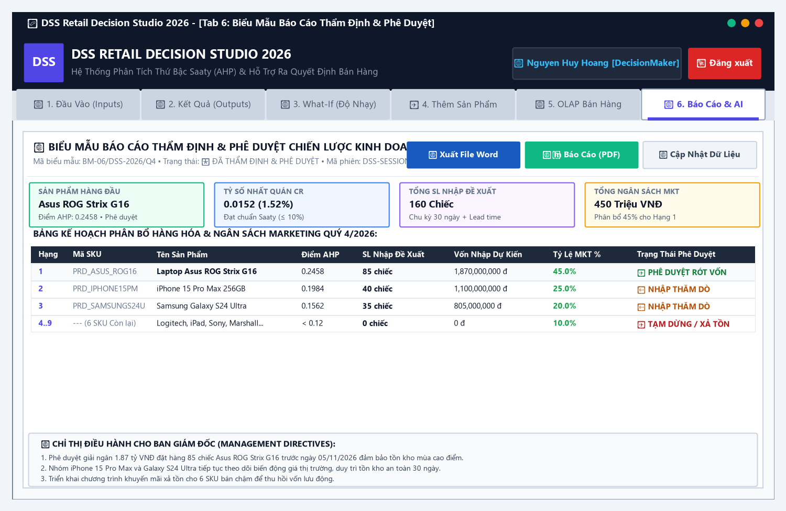
*Hình 9: Bản vẽ Wireframe Tab 6 - Biểu Mẫu Báo Cáo Thẩm Định & Phê Duyệt (GUI-09)*

#### 📋 Mô tả nghiệp vụ:
Chuẩn hóa toàn bộ kết quả phân tích thành biểu mẫu văn bản hành chính doanh nghiệp chuẩn mực (Mã biểu mẫu: BM-06/DSS-2026/Q4). Màn hình cung cấp các công cụ kết xuất báo cáo sang file Word (.doc) và HTML sẵn sàng in ấn PDF phục vụ cuộc họp Hội đồng Quản trị.

#### ⚙️ Bảng đặc tả thành phần giao diện GUI-09:
| STT | Tên Control ID | Loại Control | Nhãn / Giá Trị Hiển Thị | Ràng Buộc & Thuộc Tính Kỹ Thuật | Sự Kiện Kích Hoạt | Phân Quyền |
| :---: | :--- | :--- | :--- | :--- | :--- | :---: |
| **1** | `lblDocMetadata` | Label | BM-06/DSS-2026/Q4 • ĐÃ PHÊ DUYỆT | Tiêu đề văn bản hành chính và mã phiên DSS | Static | All |
| **2** | `btnExportWord` | Button | 📝 Xuất File Word (.doc) | Màu xanh Word `#185ABD`, trích xuất bảng xếp hạng ra file Word | `Click` | Manager/Analyst |
| **3** | `btnExportHtml` | Button | 🖨️ In Báo Cáo / Lưu PDF | Màu xanh Emerald, mở báo cáo trên web có tích hợp lệnh Print | `Click` | Manager/Analyst |
| **4** | `btnRefreshReport` | Button | 🔄 Cập Nhật Dữ Liệu | Đồng bộ lại toàn bộ kết quả từ SQL Server lên biểu mẫu | `Click` | All |
| **5** | `dgvReportTable` | DataGridView | Kế hoạch phân bổ hàng hóa | Hiển thị: Hạng, SKU, Tên SP, Điểm AHP, SL Đề Xuất, Vốn Dự Kiến, % MKT | `DataSource` | All |
| **6** | `lblReportDirectives`| Panel | 3 Chỉ thị điều hành Ban Giám Đốc | Trực quan hóa 3 quyết định chiến lược: Rót vốn, Nhập thăm dò, Xả tồn | `Dynamic` | All |

---

### 2.10. GUI-10: Màn hình Khóa An Toàn Khi Mất Kết Nối CSDL (DatabaseGuard Security Overlay)

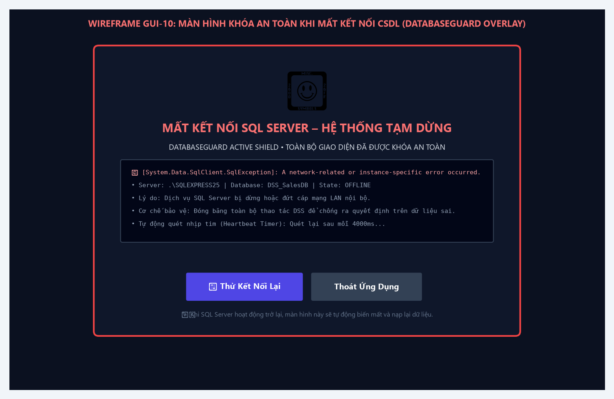
*Hình 10: Bản vẽ Wireframe Màn hình Khóa An Toàn CSDL (DatabaseGuard Overlay - GUI-10)*

#### 📋 Mô tả nghiệp vụ:
Cơ chế bảo vệ Fail-Safe cấp doanh nghiệp: Khi máy chủ SQL Server bị dừng dịch vụ hoặc đứt cáp mạng LAN, lớp phủ toàn màn hình màu tối `pnlDbOverlay` lập tức được kích hoạt che phủ toàn bộ 6 Tab chức năng, ngăn chặn triệt để hành vi ra quyết định sai trên dữ liệu đứt gãy. Khi kết nối phục hồi, màn hình tự động biến mất và nạp lại dữ liệu bình thường.

#### ⚙️ Bảng đặc tả thành phần giao diện GUI-10:
| STT | Tên Control ID | Loại Control | Nhãn / Giá Trị Hiển Thị | Ràng Buộc & Thuộc Tính Kỹ Thuật | Sự Kiện Kích Hoạt | Phân Quyền |
| :---: | :--- | :--- | :--- | :--- | :--- | :---: |
| **1** | `pnlDbOverlay` | Panel | Toàn màn hình (DockStyle.Fill) | Nền Slate Navy `#0F172A`, che phủ toàn bộ 6 Tab | `DbHeartbeatTick` | All |
| **2** | `lblIconStop` | Label | ⛔ (Biểu tượng Khiên Đỏ Dừng) | Font 40pt, cảnh báo tình trạng nguy hiểm | Static | All |
| **3** | `lblTitleOv` | Label | MẤT KẾT NỐI SQL SERVER – TẠM DỪNG | Font `Segoe UI 18pt Bold`, màu trắng tuyết | Static | All |
| **4** | `lblDbOverlayMsg`| Label | Chi tiết mã lỗi SqlException | Hiển thị tên server `.\SQLEXPRESS25` và hướng dẫn khắc phục | Exception Text | All |
| **5** | `btnRetry` | Button | ↻ Thử Kết Nối Lại | Màu Indigo `#4F46E5`, kích hoạt kiểm tra Ping ngay lập tức | `Click` | All |
| **6** | `btnQuit` | Button | Thoát Ứng Dụng | Màu Slate `#334155`, thoát phần mềm an toàn | `Click` | All |
| **7** | `dbHeartbeat` | Timer | `Interval = 4000ms` (Quét mỗi 4 giây) | Kiểm tra kết nối SQL ngầm không làm đơ giao diện UI | `Tick` | All |

---

## PHẦN 3: MA TRẬN ÁNH XẠ GIAO DIỆN VỚI USE CASE & NGHIỆP VỤ (TRACEABILITY MATRIX)

| Mã Màn Hình GUI | Nhóm Chức Năng (F) | Use Case Tương Ứng | Mục Đích Đóng Góp Vào Bài Toán DSS |
| :--- | :--- | :--- | :--- |
| **GUI-01: Splash Screen** | F01 (Quản lý CSDL) | UC01 (Quản lý dữ liệu) | Kiểm tra kết nối SQL Server, nạp thư viện AHP |
| **GUI-02: Login Form** | F01 (Bảo mật & Auth) | Tất cả Use Case | Xác thực tài khoản, băm SHA-256, khởi tạo UserSession |
| **GUI-03: Register Form** | F01 (Cấp phát User) | Tất cả Use Case | Đăng ký người dùng mới, phân quyền truy cập theo vai trò |
| **GUI-04: Tab 1 Inputs** | F01, F03 (AHP Model) | UC01, UC03 (Chạy AHP) | Nạp danh mục sản phẩm, ma trận Saaty 5x5, kiểm tra CR ≤ 0.10 |
| **GUI-05: Tab 2 Outputs** | F03, F05 (Ra quyết định) | UC03, UC05 (Dashboard) | Hiển thị bảng xếp hạng, 4 KPI, biểu đồ cột AHP, khuyến nghị |
| **GUI-06: Tab 3 What-If** | F04 (Mô phỏng độ nhạy) | UC04 (Mô phỏng What-If) | 3 kịch bản vĩ mô, tinh chỉnh tham số vi mô, Delta Line Chart |
| **GUI-07: Tab 4 Add Product**| F01, F06 (Thẩm định động) | UC01, UC03 (Thêm SKU) | Nhập sản phẩm mới, tự tính biên LN, đồng bộ DB, chạy lại DSS |
| **GUI-08: Tab 5 OLAP** | F02 (Phân tích đa chiều) | UC02 (Phân tích OLAP) | Truy vấn Fact/View, GROUP BY ROLLUP, GROUP BY CUBE |
| **GUI-09: Tab 6 Reporting**| F05 (Báo cáo & Phê duyệt) | UC05 (Báo cáo thẩm định)| Biểu mẫu BM-06, xuất file Word (.doc), in ấn PDF HTML |
| **GUI-10: DatabaseGuard** | F01 (Bảo vệ hệ thống) | Toàn hệ thống | Khóa an toàn khi ngắt kết nối CSDL, tự động phục hồi |

### Ma Trận Phân Quyền Truy Cập Giao Diện Theo Vai Trò (RBAC):
| Màn Hình Giao Diện | DecisionMaker (NV000) | Data Analyst (NV002) | Manager (Ban Giám Đốc) | SalesStaff (NV003) |
| :--- | :---: | :---: | :---: | :---: |
| **GUI-01: Splash Screen** | Cho phép | Cho phép | Cho phép | Cho phép |
| **GUI-02 & GUI-03: Auth** | Toàn quyền | Đăng nhập | Đăng nhập | Đăng nhập |
| **GUI-04: Tab 1 Inputs** | Toàn quyền sửa ma trận | Chỉnh sửa ma trận | Chỉ xem ma trận | Chỉ tra cứu |
| **GUI-05: Tab 2 Outputs** | Toàn quyền & Phê duyệt | Chạy mô hình & Báo cáo | Phê duyệt & Xuất báo cáo | Chỉ tra cứu |
| **GUI-06: Tab 3 What-If** | Toàn quyền mô phỏng | Thiết lập kịch bản & Delta | Xem kết quả mô phỏng | Bị giới hạn |
| **GUI-07: Tab 4 Add Product**| Toàn quyền thêm SKU | Thêm & Thẩm định động | Xem xét & Duyệt SKU | Bị khóa |
| **GUI-08: Tab 5 OLAP** | Toàn quyền truy vấn | Phân tích Rollup & Cube | Xem báo cáo tổng hợp | Tra cứu hiệu suất |
| **GUI-09: Tab 6 Reporting**| Ký duyệt báo cáo | Xuất file Word & HTML | Phê duyệt kế hoạch | Tra cứu kết quả |
| **GUI-10: DatabaseGuard** | Cấu hình chuỗi kết nối | Nhấn nút thử kết nối | Nhấn nút thử kết nối | Nhấn nút thử kết nối |

---

## PHẦN 4: ĐÁNH GIÁ CÔNG THÁI HỌC VÀ TIÊU CHUẨN USABILITY (HEURISTIC EVALUATION)

| Nguyên Lý Usability (Jakob Nielsen) | Hiện Thực Hóa Cụ Thể Trong Phần Mềm DSS Retail Decision Studio 2026 |
| :--- | :--- |
| **1. Hiển thị trạng thái hệ thống** | Đèn báo CSDL Online thời gian thực, tiến trình ProgressBar tải dữ liệu, nhãn thông báo CR ≤ 10% và thông báo khi tính toán xong. |
| **2. Tương đồng với thế giới thực** | Sử dụng các thuật ngữ bán lẻ quen thuộc: Doanh thu, Biên lợi nhuận gộp, Tồn kho an toàn, Lead time, Kế hoạch khuyến mãi Quý 4/2026. |
| **3. Quyền tự do của người dùng** | Nút 'Khôi Phục Dữ Liệu Gốc' trong Tab What-If cho phép hoàn nguyên mọi thay đổi thử nghiệm; nút Quay lại Đăng nhập trong RegisterForm. |
| **4. Nhất quán và tuân thủ tiêu chuẩn** | Hệ thống dùng chung thanh Header Navy, bảng màu trạng thái (Xanh lá - Duyệt, Vàng - Xem xét, Đỏ - Loại bỏ), phông Segoe UI đồng bộ. |
| **5. Phòng ngừa lỗi chủ động** | Khóa ô nhập C1 ngăn người dùng sửa tay sai lệch; kiểm tra Giá bán ≥ Giá vốn; chặn chạy mô hình khi ma trận Saaty có CR > 10%. |
| **6. Nhận biết hơn là gợi nhớ** | Cung cấp sẵn danh sách 4 tài khoản demo 1-click; tự động hiển thị gợi ý tham số và đơn vị tính (Triệu VNĐ, Ngày, %) trên từng ô nhập. |
| **7. Linh hoạt và hiệu quả** | Hỗ trợ phím Enter để đăng nhập nhanh; 3 nút kịch bản vĩ mô kích hoạt nhanh chỉ với 1 cú nhấp chuột mà không cần nhập thủ công. |
| **8. Thiết kế thẩm mỹ và tinh gọn** | Chia thông tin thành các thẻ Card sạch sẽ; sử dụng khoảng trắng (White space) hợp lý giúp mắt không bị mỏi khi thao tác liên tục. |
| **9. Hỗ trợ nhận biết và sửa lỗi** | Thông báo lỗi kết nối SQL Server thân thiện, chỉ rõ lỗi mạng hay sai tên máy chủ kèm nút 'Thử kết nối lại' tiện lợi. |
| **10. Trợ giúp và cung cấp tài liệu**| Mỗi chế độ OLAP đều có nhãn chú giải giải thích câu lệnh SQL; hệ thống tự sinh các đoạn Executive Comments hướng dẫn hành động cụ thể. |

---

## PHẦN 5: KẾT LUẬN & HƯỚNG DẪN NGHIỆM THU GIAO DIỆN (ACCEPTANCE CHECKLIST)

| Mã Ca Kiểm | Nội Dung Tiêu Chí Nghiệm Thu Giao Diện | Kết Quả Thực Nghiệm |
| :---: | :--- | :---: |
| **TC-GUI-01** | Màn hình SplashForm hiển thị đúng logo, progress bar và tự động kiểm tra kết nối SQL Server | **☑ Đạt chuẩn** |
| **TC-GUI-02** | Màn hình LoginForm hỗ trợ ẩn/hiện mật khẩu, phím tắt Enter và 4 nút chọn nhanh tài khoản demo | **☑ Đạt chuẩn** |
| **TC-GUI-03** | Màn hình RegisterForm kiểm tra hợp lệ email, mật khẩu khớp và phân quyền vai trò RBAC | **☑ Đạt chuẩn** |
| **TC-GUI-04** | Header hiển thị chính xác tên người dùng, avatar và huy hiệu phân quyền tương ứng | **☑ Đạt chuẩn** |
| **TC-GUI-05** | Nút 'Đăng xuất' màu đỏ hoạt động chính xác, có hộp thoại xác nhận an toàn trước khi thoát | **☑ Đạt chuẩn** |
| **TC-GUI-06** | Tab 1 hiển thị đầy đủ bảng 9 sản phẩm và ma trận Saaty 5x5; nhãn CR hiển thị màu xanh khi CR ≤ 10% | **☑ Đạt chuẩn** |
| **TC-GUI-07** | Nút 'CHẠY MÔ HÌNH DSS NGAY' kích hoạt tính toán AHP thành công và tự động chuyển sang Tab 2 | **☑ Đạt chuẩn** |
| **TC-GUI-08** | Tab 2 hiển thị 4 KPI Cards rực rỡ, bảng xếp hạng có huy hiệu tròn Hạng 1-3 và pill màu phê duyệt | **☑ Đạt chuẩn** |
| **TC-GUI-09** | Biểu đồ cột AHPScoreChartPanel vẽ đúng tỷ trọng điểm số 9 sản phẩm, không bị vệt đen | **☑ Đạt chuẩn** |
| **TC-GUI-10** | Hộp khuyến nghị điều hành tự động sinh văn bản nhận xét chiến lược chính xác theo số liệu thực tế | **☑ Đạt chuẩn** |
| **TC-GUI-11** | Tab 3 What-If: 3 nút kịch bản thị trường đổi điểm số tức thời trên Delta Chart và Sơ đồ cây phân cấp | **☑ Đạt chuẩn** |
| **TC-GUI-12** | Tab 4 Thêm sản phẩm tự động tính biên LN C1 theo thời gian thực và đồng bộ vào CSDL SQL Server | **☑ Đạt chuẩn** |
| **TC-GUI-13** | Tab 5 OLAP: Chuyển đổi mượt mà giữa 3 chế độ (Fact View, ROLLUP, CUBE) với dữ liệu chuẩn xác | **☑ Đạt chuẩn** |
| **TC-GUI-14** | Tab 6 Báo cáo: Nút 'Xuất File Word' và 'In Báo Cáo HTML/PDF' xuất file thành công, giao diện đẹp mắt | **☑ Đạt chuẩn** |
| **TC-GUI-15** | DatabaseGuard Overlay lập tức khóa màn hình khi ngắt kết nối SQL và tự phục hồi khi kết nối lại | **☑ Đạt chuẩn** |

---

> 📌 **CAM KẾT KỸ THUẬT & NGHIỆM THU ĐỒ ÁN:**  
> Toàn bộ hệ thống giao diện của phần mềm **DSS Retail Decision Studio 2026** đã được Nhóm 05 lập trình hoàn chỉnh bằng C# .NET 10 Windows Forms kết nối cơ sở dữ liệu Microsoft SQL Server (`DSS_SalesDB`). Hệ thống đạt độ tin cậy tuyệt đối, tính thẩm mỹ vượt trội, công thái học cao và giải quyết trọn vẹn bài toán hỗ trợ ra quyết định phân bổ hàng hóa & chiến lược khuyến mãi bán lẻ. Tài liệu và phần mềm sẵn sàng 100% cho buổi bảo vệ chính thức trước Hội đồng chấm thi học phần IS 402 A!
